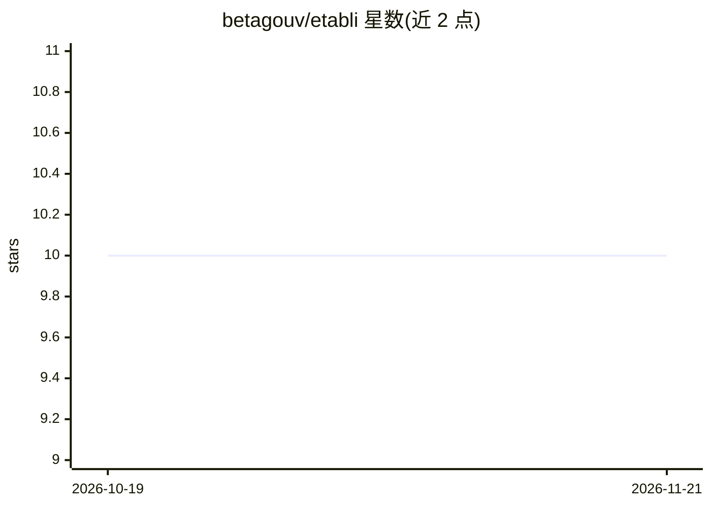

# betagouv/etabli

⭐ 10 · TypeScript · MIT · 推送 2026-11-16 · [GitHub](https://github.com/betagouv/etabli) · [官网](https://etabli.incubateur.net) · 组织维护

**法国公共数字举措目录搜索平台，支持对话式助手查询**

法国国家级平台，供政府工作人员与公民通过目录浏览或对话助手检索公共数字举措，生成举措档案。数据来源包括公共域名清单、code.gouv.fr 仓库、组织名录、Wappalyzer 指纹及 DataForSEO 外链数据；通过定期任务抓取、分析并计算数据（经自定义 CLI 手动触发），使用 Mistral API 处理 LLM 环节，以 headless Chromium 与 Semgrep 分析网站与代码。部署于 Clever Cloud（Docker + PostgreSQL v18），本地开发需数据库、Pandoc、Semgrep、Bibliothecary。

## 筛选速览

| 维度 | 判定 | 备注 |
|---|---|---|
| AI 角色 | `ai-enhanced` | 去掉 AI 部分产品仍成立 |
| 许可风险 | `permissive` | MIT |
| 部署形态 | `self-host` | docker 或自建部署 |
| 模型依赖 | — | README 未给出锁定关系 |
| 硬件要求 | — | 无带数字的原话,不猜 |
| 安装摩擦 | `low` | 无编译、无系统依赖或容器化 |
| 成熟度 | `idea` | |

## 能力要点

- 目录检索与对话式助手两种查询方式
- 聚合多个公共数据集生成举措档案
- CLI 触发的定期数据抓取与分析任务
- 助手会话历史支持 via Clever Cloud 粘性会话

## 适用场景

- 查找法国政府机构已上线的数字服务
- 了解某公共举措使用的工具与代码仓库
- 通过助手对话检索公共数字举措信息

## 场景标签

`聊天机器人` `语义搜索` · 领域:对话与助手

## 证据(README 行号)

> L3: A french national platform allowing agents and citizens to search for public digital initiatives across a directory 
> L202: - `MISTRAL_API_KEY`: [SECRET] _(you can create an API key from your MistralAI "La plateforme" account)_

## 星数曲线

2026-10-19 10 → 2026-11-21 10（+0）

---
*卡片 v1 · prompt 1.4 · 生成 2026-11-19 · 置信度 mid · 依据 README sha `2102aa163d1a` · [字段定义](../../DATASET.md)*
