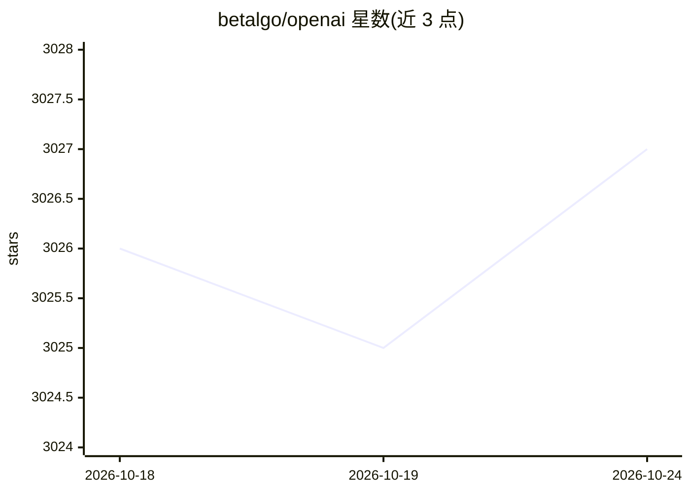

# betalgo/openai

⭐ 3,027 · C# · MIT · 推送 2026-03-21 · [GitHub](https://github.com/betalgo/openai) · [官网](https://ranultinga.com/) · 个人维护

**.NET 社区库：在 .NET 应用中接入 OpenAI API**

由 Betalgo Ranul 维护的 .NET 社区库，封装 OpenAI API 的调用能力，覆盖 ChatCompletion、图像生成、Realtime API 等，随版本更新补充模型列表与 reasoning effort 参数。支持直接实例化与依赖注入两种接入方式，可设置默认模型与 API key/Organization 配置，附 Playground 示例工程。包 ID 已由 Betalgo.OpenAI 迁移为 Betalgo.Ranul.OpenAI；支持 .NET 8/9，.NET 6/7 支持已结束。

## 筛选速览

| 维度 | 判定 | 备注 |
|---|---|---|
| AI 角色 | `ai-ecosystem` | LLM/agent 周边工具 |
| 许可风险 | `permissive` | MIT |
| 部署形态 | `None` |  |
| 模型依赖 | — | README 未给出锁定关系 |
| 硬件要求 | — | 无带数字的原话,不猜 |
| 安装摩擦 | `medium` | 含编译或系统依赖之一 |
| 成熟度 | — | 结构信号不足 |

## 能力要点

- 封装 OpenAI API（Chat、图像生成、Realtime 等）供 .NET 应用调用
- 支持依赖注入与直接实例化两种接入方式
- 提供 OpenAI.Playground 示例工程与功能可用性表格
- 引入 Contracts 项目集中管理请求/响应模型（9.2.0 起）

## 适用场景

- 在 C#/.NET 项目中集成 OpenAI 的对话与图像生成能力
- 通过示例工程了解库的用法
- 随 OpenAI 新模型发布更新模型列表后使用新模型

## 场景标签

 · 领域:LLM 基础设施/SDK

## 证据(README 行号)

> L4: A .NET Library for accessing OpenAI's API, provided as a community library. This Library allows you to integrate Ope
> L53: var openAIService = new OpenAIService(new OpenAIOptions()

## 星数曲线

2026-10-18 3,026 → 2026-10-24 3,027（+1）

---
*卡片 v1 · prompt 1.4 · 生成 2026-10-20 · 置信度 high · 依据 README sha `af2018c8a00c` · [字段定义](../../DATASET.md)*
