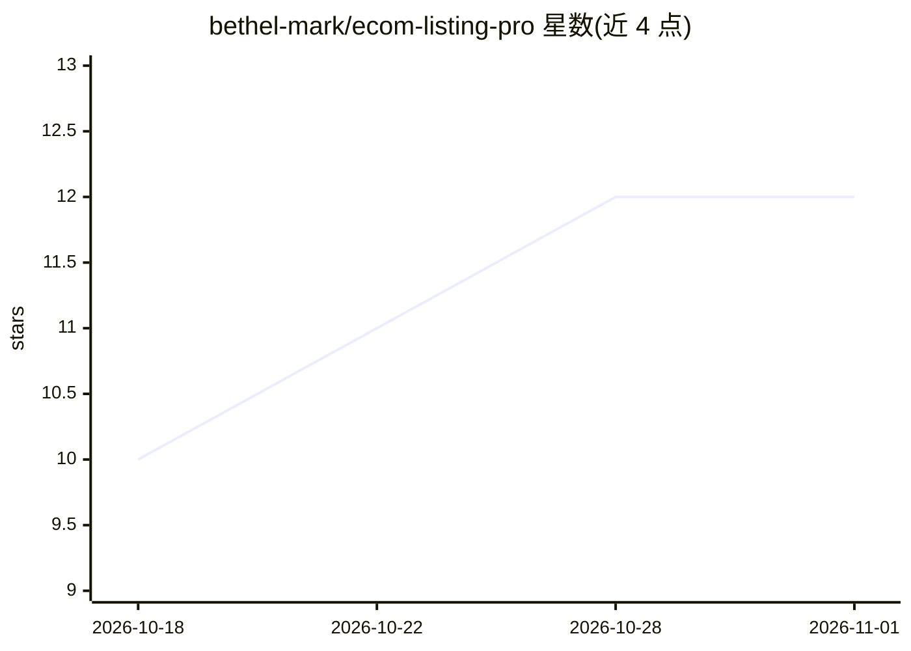

# bethel-mark/ecom-listing-pro

⭐ 12 · 推送 2026-07-20 · [GitHub](https://github.com/bethel-mark/ecom-listing-pro) · [官网](https://github.com/bethel-mark/ecom-listing-pro) · 个人维护 · 中文 README

**Codex 电商上架优化技能：自动诊断图片、重写标题、生成轮播图方案**

面向 Codex 的电商 listing 优化技能包（SKILL.md 形式）：上传商品图后自动识别主体、诊断图片、检测并处理水印（AI 水印反透明混合/传统水印 LaMa 修补），按标题公式（情感钩子+材质+品类词+规格+场景+信任锚点）重写标题，并根据品类从 8 种设计风格中匹配方案，生成 6 图轮播叙事提示词。支持跨境/国内双模式与多平台规则，输出含优化标题与轮播图 prompt，最多 3 轮自检迭代。

## 筛选速览

| 维度 | 判定 | 备注 |
|---|---|---|
| AI 角色 | `ai-native` | 本体是模型或模型工具 |
| 许可风险 | `none` | — |
| 部署形态 | `None` |  |
| 模型依赖 | — | README 未给出锁定关系 |
| 硬件要求 | — | 无带数字的原话,不猜 |
| 安装摩擦 | `low` | 无编译、无系统依赖或容器化 |
| 成熟度 | — | 结构信号不足 |

## 能力要点

- 按品类从 8 种设计风格（玻璃拟态/等距3D/赛博朋克等）自动匹配轮播图方案
- 水印检测与去除：AI 水印（反透明混合）与传统水印（LaMa 修补）
- 跨境/国内双模式，跨境严限中文/人脸/促销字眼
- 标题公式嵌入 5-7 个搜索关键词，最多 3 轮自检微调

## 适用场景

- 跨境卖家批量优化商品标题与轮播图方案
- 上传商品图后获得图片诊断与可上架素材生成提示词
- 根据品类获得匹配的设计风格建议

## 场景标签

`AI 写作` `图像视频处理` · 领域:内容生成

## 证据(README 行号)

> L3: > **AI-driven e-commerce listing optimization: auto-diagnose product images, rewrite titles for max conversion, desi
> L63: ├── SKILL.md                          # Main skill file (core workflow + design system)

## 星数曲线

2026-10-18 10 → 2026-11-01 12（+2）

---
*卡片 v1 · prompt 1.4 · 生成 2026-11-01 · 置信度 high · 依据 README sha `369c45cdc8c1` · [字段定义](../../DATASET.md)*
