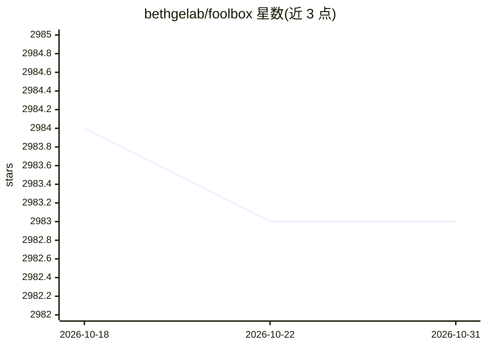

# bethgelab/foolbox

⭐ 2,983 · Python · MIT · 推送 2025-12-03 · [GitHub](https://github.com/bethgelab/foolbox) · [官网](https://foolbox.jonasrauber.de) · 组织维护

**对深度学习模型构造对抗样本、评测鲁棒性的 Python 库**

Foolbox 是一个 Python 库，用于对 PyTorch、TensorFlow、JAX 深度学习模型运行对抗攻击以评测模型鲁棒性。基于 EagerPy 重写（Foolbox 3），单一代码库原生支持三个框架并带批量支持，提供大量基于梯度与基于决策的攻击算法。框架（PyTorch/TensorFlow/JAX）需用户自行安装，不作为依赖声明；测试版本为 PyTorch 1.10.1、TensorFlow 2.6.3、JAX 0.2.517，兼容 Python 3.8+。附 JOSS 与 ICML workshop 论文、教程 notebook 与示例代码。

## 筛选速览

| 维度 | 判定 | 备注 |
|---|---|---|
| AI 角色 | `ai-ecosystem` | LLM/agent 周边工具 |
| 许可风险 | `permissive` | MIT |
| 部署形态 | `library` | 以包/库形式分发 |
| 模型依赖 | — | README 未给出锁定关系 |
| 硬件要求 | — | 无带数字的原话,不猜 |
| 安装摩擦 | `medium` | 含编译或系统依赖之一 |
| 成熟度 | — | 结构信号不足 |

## 能力要点

- 单一代码库原生支持 PyTorch、TensorFlow、JAX 并带批量支持
- 提供大量基于梯度与基于决策的对抗攻击算法
- 类型注解覆盖，运行前可捕获部分 bug

## 适用场景

- 对自训模型跑 PGD 等对抗攻击，评测其鲁棒性
- 在多个框架间复用同一套攻击代码做对比实验
- 论文中引用并复现对抗鲁棒性基准

## 场景标签

`模型评测` · 领域:评测与运维

## 证据(README 行号)

> L15: Foolbox: Fast adversarial attacks to benchmark the robustness of machine learning models in PyTorch, TensorFlow, an
> L27: - **State-of-the-art attacks**: Foolbox provides a large collection of state-of-the-art gradient-based and decision

## 星数曲线

2026-10-18 2,984 → 2026-10-31 2,983（-1）

---
*卡片 v1 · prompt 1.4 · 生成 2026-10-20 · 置信度 high · 依据 README sha `336336616231` · [字段定义](../../DATASET.md)*
