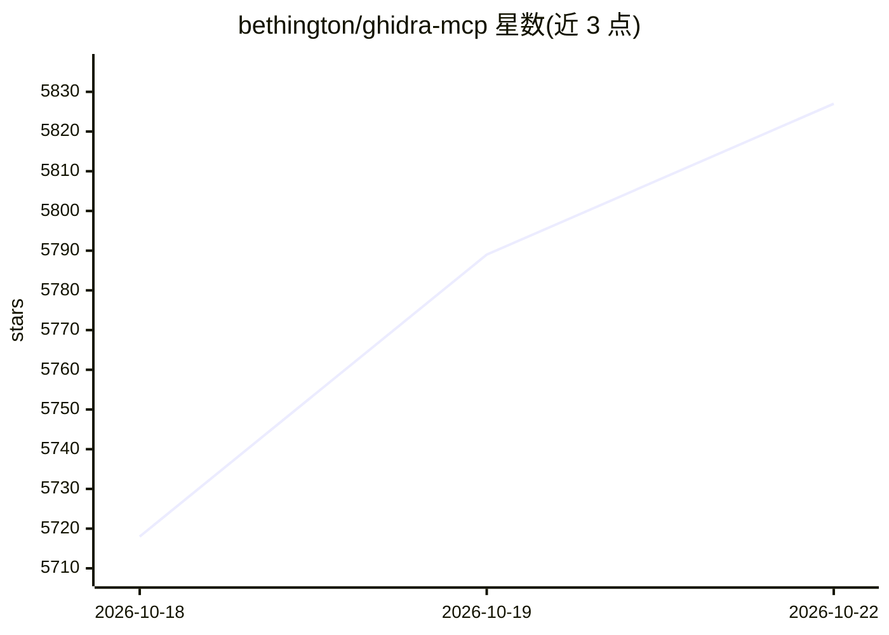

# bethington/ghidra-mcp

⭐ 5,848 · Java · Apache-2.0 · 推送 2026-10-21 · [GitHub](https://github.com/bethington/ghidra-mcp) · 个人维护

**连接 Ghidra 逆向工程与 AI 工具的 MCP 服务器（209 个工具）**

为 Ghidra 提供的 Model Context Protocol 服务器，含 GUI 插件与无头（headless）服务器两种形态：将 Ghidra 的反编译、交叉引用、P-code 仿真、实时调试、数据流分析等能力封装为 209 个 MCP 工具，供 AI 客户端调用，支持读写重命名/类型/注释、批量操作、命名约定强制执行、跨二进制文档迁移及 Ghidra Server 集成，可 Docker 部署。要求 Ghidra 12.1.4 与 Java 21，扩展仅加载对应构建版本。面向使用 AI 助手做逆向工程的开发者和安全研究员。

## 筛选速览

| 维度 | 判定 | 备注 |
|---|---|---|
| AI 角色 | `ai-ecosystem` | LLM/agent 周边工具 |
| 许可风险 | `permissive` | Apache-2.0 |
| 部署形态 | `desktop` | 安装包/桌面程序 |
| 模型依赖 | — | README 未给出锁定关系 |
| 硬件要求 | — | 无带数字的原话,不猜 |
| 安装摩擦 | `medium` | 含编译或系统依赖之一 |
| 成熟度 | — | 结构信号不足 |

## 能力要点

- 209 个 MCP 工具覆盖反编译、数据流、P-code 仿真与实时调试
- GUI 插件与无头服务器两种模式，支持 Docker 与 CI/CD
- 工具层命名约定强制执行（auto-fix/warn/reject 三级）
- SHA-256 函数哈希匹配实现跨二进制版本文档迁移

## 适用场景

- 让 AI 客户端直接调用 Ghidra 做二进制分析与函数文档化
- 在 CI/CD 流水线中以无头模式批量自动化逆向分析
- 通过 MCP 对多个二进制版本同步传播逆向文档

## 场景标签

`网络安全` · 领域:学习与行业

## 证据(README 行号)

> L25: A production-ready Model Context Protocol (MCP) server that bridges Ghidra's powerful reverse engineering capabilit
> L112: - **Full MCP Compatibility** — Complete implementation of Model Context Protocol
> L53: 5. **Point your MCP client at it**, using the absolute path (`which

## 星数曲线

2026-10-18 5,718 → 2026-10-22 5,827（+109）

---
*卡片 v1 · prompt 1.4 · 生成 2026-10-20 · 置信度 mid · 依据 README sha `fefb92bc8119` · [字段定义](../../DATASET.md)*
