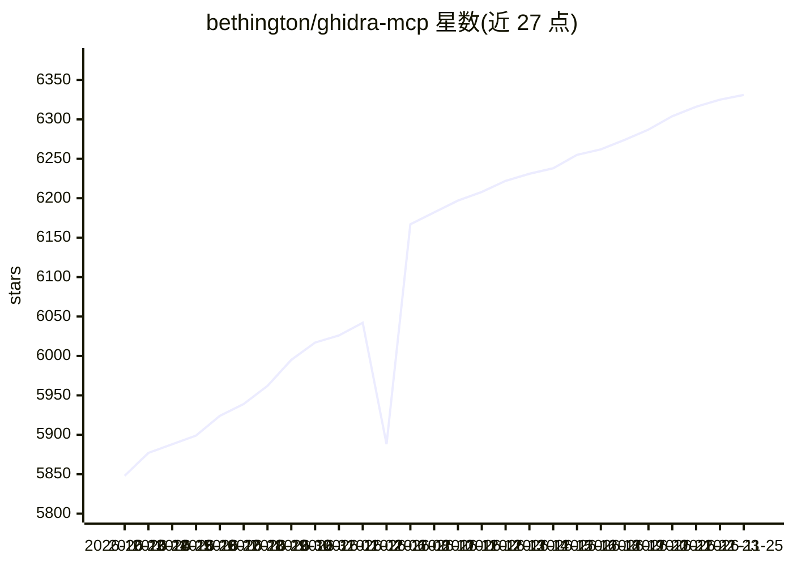

# bethington/ghidra-mcp

⭐ 6,331 · Java · Apache-2.0 · 推送 2026-11-20 · [GitHub](https://github.com/bethington/ghidra-mcp) · 个人维护

**给逆向工程师的 Ghidra MCP 服务器，连接 AI 工具**

一个 Model Context Protocol 服务器与 Ghidra 扩展，将 Ghidra 的逆向工程能力暴露给 MCP 客户端：提供 219 个工具，覆盖反编译、调用图、P-code 模拟、调试器集成、批量重命名/注释/类型标注与脚本执行。以 Ghidra GUI 插件或 headless 服务器两种方式运行，工具层强制命名与文档规范，支持跨二进制版本的函数哈希匹配文档传递、Ghidra Server 多用户协作及 Docker 部署。前置要求 Ghidra 12.2、Java 25 与 uv。

## 筛选速览

| 维度 | 判定 | 备注 |
|---|---|---|
| AI 角色 | `ai-ecosystem` | LLM/agent 周边工具 |
| 许可风险 | `permissive` | Apache-2.0 |
| 部署形态 | `desktop` | 安装包/桌面程序 |
| 模型依赖 | — | README 未给出锁定关系 |
| 硬件要求 | — | 无带数字的原话,不猜 |
| 安装摩擦 | `medium` | 含编译或系统依赖之一 |
| 成熟度 | — | 结构信号不足 |

## 能力要点

- 219 个 MCP 工具，含写操作与批量操作
- 工具层强制命名/类型/文档规范（auto-fix/warn/reject 三档）
- P-code 模拟与 16 个调试器端点（GUI 插件模式）
- 支持 headless 服务器、Docker 与 CI/CD 流水线

## 适用场景

- 在 MCP 客户端中让 AI 辅助分析 Ghidra 中打开的二进制
- 批量重命名、注释与类型标注并保持团队规范一致
- 在 CI/CD 中以 headless/Docker 方式自动化二进制分析
- 跨版本二进制的函数匹配与文档传递

## 场景标签

`网络安全` · 领域:学习与行业

## 证据(README 行号)

> L25: A production-ready Model Context Protocol (MCP) server that bridges Ghidra's powerful reverse engineering capabilit
> L112: - **Full MCP Compatibility** — Complete implementation of Model Context Protocol

## 星数曲线

2026-10-23 5,848 → 2026-11-25 6,331（+483）

---
*卡片 v1 · prompt 1.4 · 生成 2026-11-22 · 置信度 mid · 依据 README sha `0b3ff8ef7dd4` · [字段定义](../../DATASET.md)*
