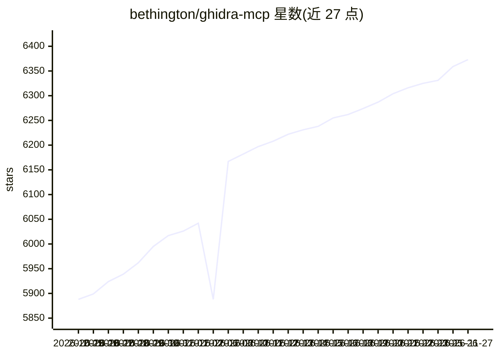

# bethington/ghidra-mcp

⭐ 6,373 · Java · Apache-2.0 · 推送 2026-11-25 · [GitHub](https://github.com/bethington/ghidra-mcp) · 个人维护

**让 AI 客户端通过 MCP 调用 Ghidra 做逆向工程的桥接服务器**

实现 Model Context Protocol 的服务器，将 Ghidra 的逆向工程能力桥接给 AI 客户端与自动化框架。由 Ghidra 扩展（HTTP 服务）与 Python wheel 形式的 MCP bridge 两部分组成，提供 219 个工具，覆盖反编译、调用图、P-code 模拟、调试器端点、脚本执行、批量重命名/注释/类型化及跨二进制文档迁移；命名与类型规范在工具层自动修复、警告或拒绝。发布形式含 release zip/wheel、源码构建与 Docker。运行依赖 Ghidra 12.2 与 Java 25，扩展仅加载于构建时对应的 Ghidra 版本。

## 筛选速览

| 维度 | 判定 | 备注 |
|---|---|---|
| AI 角色 | `ai-ecosystem` | LLM/agent 周边工具 |
| 许可风险 | `permissive` | Apache-2.0 |
| 部署形态 | `desktop` | 安装包/桌面程序 |
| 模型依赖 | — | README 未给出锁定关系 |
| 硬件要求 | — | 无带数字的原话,不猜 |
| 安装摩擦 | `medium` | 含编译或系统依赖之一 |
| 成熟度 | — | 结构信号不足 |

## 能力要点

- 219 个 MCP 工具，含读写操作与 P-code 模拟、调试器端点
- 工具层强制命名/类型规范（自动修复/警告/拒绝三级）
- headless 与 GUI 两种模式，Docker 可用于 CI/CD
- SHA-256 函数哈希匹配实现跨版本文档迁移

## 适用场景

- 用 AI 客户端辅助分析二进制并生成函数文档
- 批量重命名与注释大型逆向工程项目
- 在 CI/CD 中以 headless/Docker 方式自动化二进制分析
- 团队间统一逆向产出的命名与类型规范

## 场景标签

`网络安全` · 领域:学习与行业

## 证据(README 行号)

> L25: A production-ready Model Context Protocol (MCP) server that bridges Ghidra's powerful reverse engineering capabilit
> L92: - **Headless and GUI modes** — Run with or without the Ghidra GUI. Docker-ready for CI/CD pipelines and automated a
> L117: - **Full MCP Compatibility** — Complete implementation of Model Context Protocol

## 星数曲线

2026-10-25 5,888 → 2026-11-27 6,373（+485）

---
*卡片 v1 · prompt 1.4 · 生成 2026-11-26 · 置信度 high · 依据 README sha `000cc66c3b34` · [字段定义](../../DATASET.md)*
