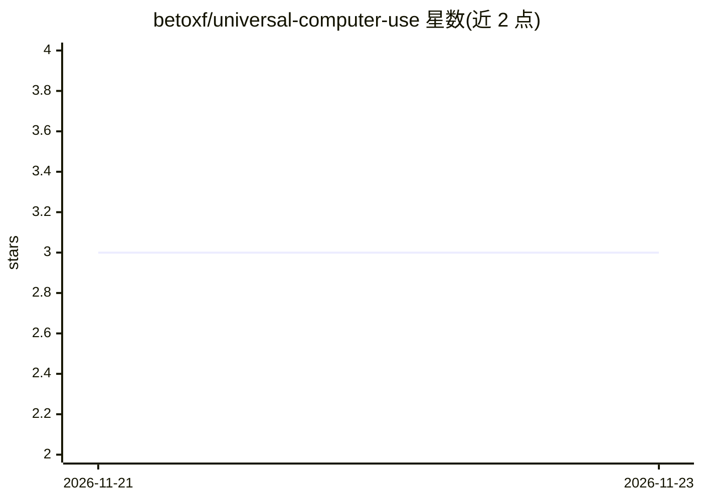

# betoxf/universal-computer-use

⭐ 3 · Rust · Apache-2.0 · 推送 2026-11-20 · [GitHub](https://github.com/betoxf/universal-computer-use) · 个人维护

**让 AI agent 在后台操作 Mac 应用的 MCP 服务器**

UCU 是一个 MCP 服务器，供 Claude Code、opencode 及其他 MCP 客户端在 macOS 上后台操作应用：agent 可点击、输入和读取其他应用，不移动指针也不抢占焦点；被驱动的应用运行在私有桌面上。支持按坐标点击元素、向无辅助功能树的原生窗口发送原始输入，提供 Safari 与 Chrome 工具在独立窗口运行；每个会话有独立引擎与光标颜色并相互感知。基于 Vercel Labs 的 agent-desktop（Rust 引擎）构建，仓库还包含安装器与文档，用户可按应用授权或拒绝。

## 筛选速览

| 维度 | 判定 | 备注 |
|---|---|---|
| AI 角色 | `ai-ecosystem` | LLM/agent 周边工具 |
| 许可风险 | `permissive` | Apache-2.0 |
| 部署形态 | `None` |  |
| 模型依赖 | — | README 未给出锁定关系 |
| 硬件要求 | — | 无带数字的原话,不猜 |
| 安装摩擦 | `low` | 无编译、无系统依赖或容器化 |
| 成熟度 | — | 结构信号不足 |

## 能力要点

- 后台操作应用，不移动指针或抢占焦点
- 无辅助功能树的窗口也可按坐标发送原始输入
- Safari/Chrome 工具在独立窗口运行，保留用户标签页与键盘
- 读取小窗口约 260 ms、169 tokens，单次调用执行多步

## 适用场景

- 让编码 agent 自主测试和驱动 Mac 上的 GUI 应用
- 多个聊天会话并行操作同一应用互不干扰
- 对无辅助功能树的画布类应用做自动化操作

## 场景标签

`GUI 自动化` · 领域:效率与自动化

## 证据(README 行号)

> L5:  An MCP server for Claude Code, opencode and any MCP client. Built on agent-desktop from Vercel Labs.
> L9:  MCP server

## 星数曲线

2026-11-21 3 → 2026-11-23 3（+0）

---
*卡片 v1 · prompt 1.4 · 生成 2026-11-22 · 置信度 high · 依据 README sha `6334705dfec0` · [字段定义](../../DATASET.md)*
