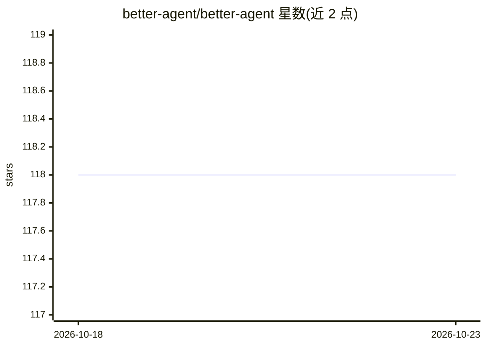

# better-agent/better-agent

⭐ 118 · TypeScript · MIT · 推送 2026-06-01 · [GitHub](https://github.com/better-agent/better-agent) · [官网](https://www.better-agent.com) · 组织维护

**构建有类型、可持久化 AI Agent 应用的 TypeScript 框架**

面向 TypeScript 开发者的 Agent 应用构建框架：提供统一可组合的运行时，覆盖工具、记忆、存储、认证上下文、中断、可恢复运行、插件与跨框架类型化客户端，支持 AG-UI 事件流。设计目标包括端到端类型化（从定义到客户端调用）、融入现有技术栈（应用/数据库/认证），以及将可复用行为打包为插件共享。README 声明处于 beta 阶段，API 可能随开发变化。安装与快速上手依赖文档站，README 内未给出具体命令。

## 筛选速览

| 维度 | 判定 | 备注 |
|---|---|---|
| AI 角色 | `ai-ecosystem` | LLM/agent 周边工具 |
| 许可风险 | `permissive` | MIT |
| 部署形态 | `None` |  |
| 模型依赖 | — | README 未给出锁定关系 |
| 硬件要求 | — | 无带数字的原话,不猜 |
| 安装摩擦 | `low` | 无编译、无系统依赖或容器化 |
| 成熟度 | `idea` | |

## 能力要点

- 统一可组合运行时：工具/记忆/存储/认证上下文/中断/可恢复运行/插件
- AG-UI 事件流支持
- 跨框架的类型化客户端，端到端类型定义

## 适用场景

- 用 TypeScript 构建类型安全的 AI Agent 应用
- 搭建可持久化、可中断恢复的对话与任务流
- 以插件形式打包复用 Agent 行为

## 场景标签

`Agent 框架` · 领域:Agent 开发

## 证据(README 行号)

> L18: Better Agent is a TypeScript framework for building typed, durable agent apps with AG-UI event streaming.
> L20: It gives you one composable runtime for tools, memory, storage, auth context, interrupts, resumable runs, plugins, 

## 星数曲线

2026-10-18 118 → 2026-10-23 118（+0）

---
*卡片 v1 · prompt 1.4 · 生成 2026-10-23 · 置信度 high · 依据 README sha `41c8a8bf605e` · [字段定义](../../DATASET.md)*
