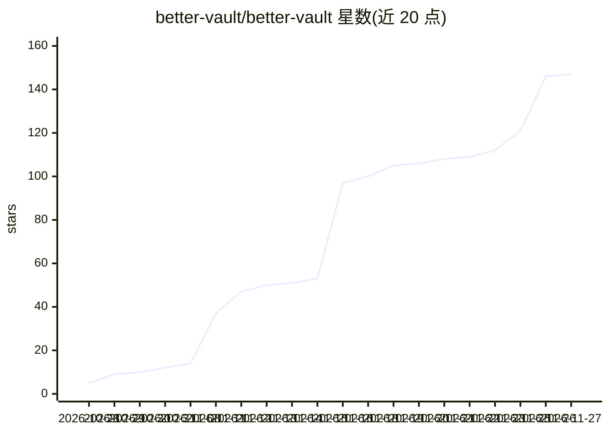

# better-vault/better-vault

⭐ 147 · TypeScript · NOASSERTION · 推送 2026-11-26 · [GitHub](https://github.com/better-vault/better-vault) · [官网](https://better-vault.dev) · 组织维护

**开源 NotebookLM 替代：对资料提问并生成学习材料**

自托管的 research notebook：用户向笔记本添加 PDF、网页、笔记等来源，通过自选模型对话并获得带引用的回答，在 Studio 中从来源生成报告、闪卡、测验、数据表、思维导图、幻灯片、信息图等，支持 Word/Markdown/PowerPoint 等格式导出。模型可用 OpenAI/Anthropic/Google 的自有 key 或本地 Ollama/LM Studio。Web 版数据存浏览器 IndexedDB，桌面版存 SQLite，无账号与服务器数据库。音频/视频概览不在范围内。

## 筛选速览

| 维度 | 判定 | 备注 |
|---|---|---|
| AI 角色 | `ai-native` | 本体是模型或模型工具 |
| 许可风险 | `permissive` | NOASSERTION |
| 部署形态 | `library` | 以包/库形式分发 |
| 模型依赖 | local-ok | 支持本地模型 |
| 硬件要求 | — | 无带数字的原话,不猜 |
| 安装摩擦 | `low` | 无编译、无系统依赖或容器化 |
| 成熟度 | — | 结构信号不足 |

## 能力要点

- 带引用的来源问答，Web 模式可用内置联网搜索的 provider
- Studio 生成报告、闪卡、测验、思维导图、幻灯片等 9 类产出并可导出
- BYOK：OpenAI/Anthropic/Google 自有 key 或本地 Ollama/LM Studio
- local-first：数据存浏览器 IndexedDB 或桌面版 SQLite，无账号

## 适用场景

- 把论文和网页资料导入笔记本做带引用的提问
- 从课程材料生成闪卡、测验和学习指南
- 不依赖云账号、用本地模型处理个人资料

## 场景标签

`知识库管理` `文档问答` · 领域:知识与检索

## 证据(README 行号)

> L25: better-vault is a free, open-source alternative to Google NotebookLM (now Gemini Notebook). It is a research notebo
> L31: **Choose your model** from OpenAI, Anthropic and Google with your own key, or run a local model through Ollama or L
> L33: **Keep your data on your device.** The web app stores everything in your browser's IndexedDB, and the **desktop app

## 星数曲线

2026-10-28 5 → 2026-11-27 147（+142）

---
*卡片 v1 · prompt 1.4 · 生成 2026-11-27 · 置信度 high · 依据 README sha `713d3e05930a` · [字段定义](../../DATASET.md)*
