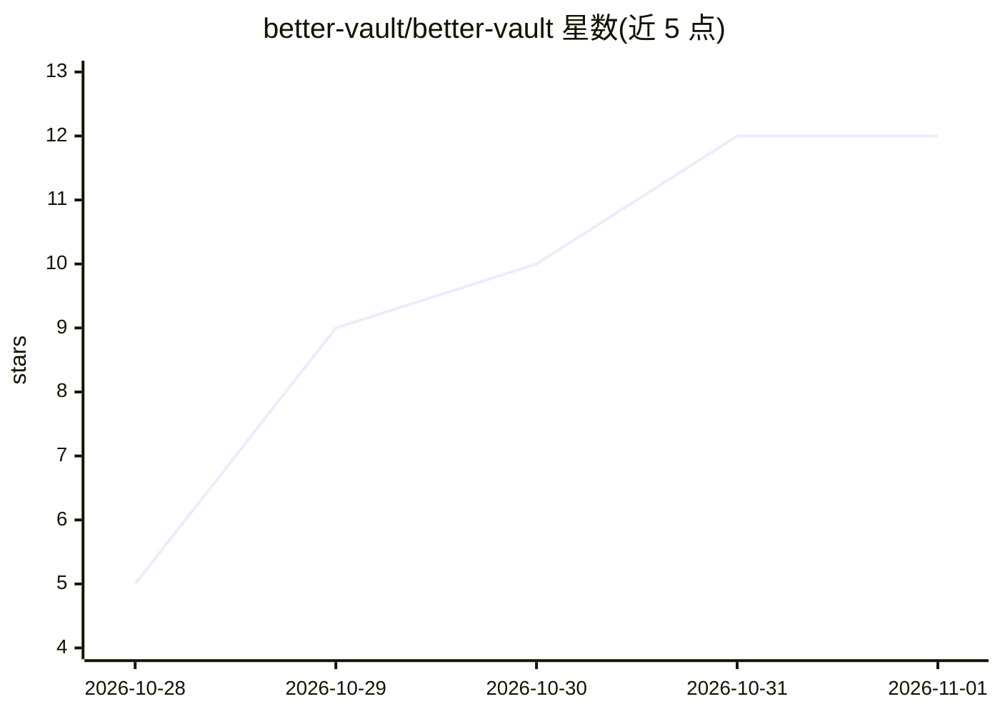

# better-vault/better-vault

⭐ 12 · TypeScript · NOASSERTION · 推送 2026-10-29 · [GitHub](https://github.com/better-vault/better-vault) · [官网](https://better-vault.dev) · 组织维护

**开源 NotebookLM 替代品：用自选模型与资料对话并生成学习材料**

本地优先的研究笔记本应用：把 PDF、网页、笔记等加入笔记本后，可用自选 AI 模型与资料对话并获得带引用的回答，或在 Studio 中生成报告、闪卡、测验、数据表、思维导图、幻灯片、信息图与解剖图，支持导出 Word/PPT/CSV 等格式。模型接入支持 OpenAI、Anthropic、Google 的自有 API key 或本地 Ollama/LM Studio。数据存于浏览器 IndexedDB 或桌面端 SQLite 文件，无账户、无服务端数据库。提供 macOS/Windows/Linux 桌面安装包，也可从 Node.js 源码运行。音频与视频概览不在范围内。

## 筛选速览

| 维度 | 判定 | 备注 |
|---|---|---|
| AI 角色 | `ai-native` | 本体是模型或模型工具 |
| 许可风险 | `permissive` | NOASSERTION |
| 部署形态 | `library` | 以包/库形式分发 |
| 模型依赖 | local-ok | 支持本地模型 |
| 硬件要求 | — | 无带数字的原话,不猜 |
| 安装摩擦 | `low` | 无编译、无系统依赖或容器化 |
| 成熟度 | — | 结构信号不足 |

## 能力要点

- 对话回答带来源段落引用，支持 Web 搜索模式
- Studio 生成报告/闪卡/测验/思维导图/幻灯片/信息图等多种产物
- 支持 OpenAI/Anthropic/Google 自有 key 及本地 Ollama/LM Studio
- 本地优先：数据存 IndexedDB 或 SQLite，无账户无服务端数据库

## 适用场景

- 把课程资料、论文、网页整理进笔记本并向 AI 提问
- 将学习资料转化为闪卡、测验和思维导图复习
- 用本地模型处理资料而不上传数据
- 从多个来源生成带引用的报告和演示文稿

## 场景标签

`知识库管理` `文档问答` `AI 写作` · 领域:内容生成

## 证据(README 行号)

> L25: better-vault is a free, open-source alternative to Google NotebookLM (now Gemini Notebook). It is a research notebo
> L29: **Create study material** in the **Studio**: reports, flashcards, quizzes, data tables, mind maps, slide decks, inf

## 星数曲线

2026-10-28 5 → 2026-11-01 12（+7）

---
*卡片 v1 · prompt 1.4 · 生成 2026-11-01 · 置信度 high · 依据 README sha `96a532453549` · [字段定义](../../DATASET.md)*
