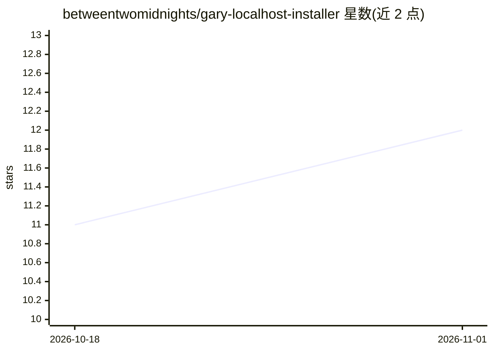

# betweentwomidnights/gary-localhost-installer

⭐ 12 · Python · 推送 2026-10-30 · [GitHub](https://github.com/betweentwomidnights/gary-localhost-installer) · [官网](https://thecollabagepatch.com) · 个人维护

**一键安装并管理 7 个本地音乐生成模型的 Windows 控制中心**

gary4local 是基于 Tauri、Rust 和 Svelte 的 Windows 控制中心，用于在本地计算机上安装和运行 7 个音乐模型服务（MusicGen、MelodyFlow、ACE-Step、Stable Audio、Stable Audio 3、Foundation-1、YuE2），各服务以 localhost HTTP 端点提供，供 gary4juce 插件在 DAW 内或独立应用调用。稳定音频类服务正从 Python 后端迁移到共享的 C++ 运行时（sa3.cpp），可选择 CUDA 或 Vulkan 后端。支持 LoRA 训练、模型下载、托盘菜单、自动更新与自定义运行时存储位置。构建需 Node.js 20+、Rust 工具链与 WebView2。

## 筛选速览

| 维度 | 判定 | 备注 |
|---|---|---|
| AI 角色 | `ai-ecosystem` | LLM/agent 周边工具 |
| 许可风险 | `none` | — |
| 部署形态 | `desktop` | 安装包/桌面程序 |
| 模型依赖 | — | README 未给出锁定关系 |
| 硬件要求 | — | 无带数字的原话,不猜 |
| 安装摩擦 | `medium` | 含编译或系统依赖之一 |
| 成熟度 | — | 结构信号不足 |

## 能力要点

- 一键安装并管理 7 个本地音乐生成模型服务（localhost 端点）
- stable audio 类服务可迁移到共享 C++ 运行时 sa3.cpp（CUDA/Vulkan 后端）
- 内置 LoRA 本地训练入口与生成的 adapter 加载
- 自定义运行时存储位置（可迁移到外部硬盘）

## 适用场景

- 配合 gary4juce 插件在 DAW 内运行本地音乐生成模型
- 用独立应用一键安装和管理多个音乐生成服务
- 对音乐模型做本地 LoRA 微调并加载使用

## 场景标签

`微调` · 领域:训练与推理

## 证据(README 行号)

> L3: this is a windows control center for running 7 music models directly on your
> L74: - `gary` / MusicGen: `http://localhost:8000` via audiocraft
> L75: - `terry` / MelodyFlow: `http://localhost:8002` via MelodyFlow
> L76: - `carey` / ACE-Step: `http://localhost:8003` via ACE-Step 1.5 with localhost `lego`, `extract`, `complete`, and `c
> L77: - `jerry` / Stable Audio: `http://localhost:8005` via sa3.cpp, running stable-audio-open-small and its kickbass and
> L78: - `sa3` / Stable Audio 3: `http://localhost:8006` via sa3.cpp, running stable-audio-3

## 星数曲线

2026-10-18 11 → 2026-11-01 12（+1）

---
*卡片 v1 · prompt 1.4 · 生成 2026-11-01 · 置信度 high · 依据 README sha `6387bf60c6b5` · [字段定义](../../DATASET.md)*
