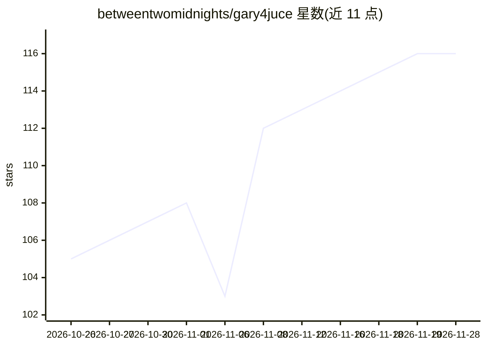

# betweentwomidnights/gary4juce

⭐ 116 · C++ · AGPL-3.0 · 推送 2026-11-26 · [GitHub](https://github.com/betweentwomidnights/gary4juce) · [官网](https://thecollabagepatch.com) · 个人维护

**让音乐人在 DAW 内直接调用 AI 音乐模型的 VST3/AU 插件**

基于 JUCE 的音频插件（VST3/AU + 独立运行版），将 8 个 AI 音乐模型（YuE2、stable-audio-3、MusicGen、stable-audio-open-small、Foundation-1、ACE-Step、Melodyflow、Magenta Realtime）与一个基于 stems.cpp 的本地 stem 分离器集成进 Ableton、FL Studio、Logic 等 DAW 工作流。支持录制缓冲送入模型做生成、续写、变换与循环，输出可作为 MIDI 拖入工程。后端可选远程自托管（DGX Spark）或通过配套 gary4local 本地运行（需 GPU，10GB+ VRAM）。Windows/macOS 提供安装包，Linux 为 preview。

## 筛选速览

| 维度 | 判定 | 备注 |
|---|---|---|
| AI 角色 | `ai-native` | 本体是模型或模型工具 |
| 许可风险 | `viral` | AGPL-3.0 |
| 部署形态 | `desktop` | 安装包/桌面程序 |
| 模型依赖 | — | README 未给出锁定关系 |
| 硬件要求 | — | 无带数字的原话,不猜 |
| 安装摩擦 | `low` | 无编译、无系统依赖或容器化 |
| 成熟度 | `idea` | |

## 能力要点

- 8 个 AI 音乐模型嵌入 DAW：文本生成音乐、音频续写、变换、BPM/调性感知循环
- 内置 stems.cpp stem 分离器，在本机拆分输出或录音缓冲
- 生成的乐谱可编辑并以 MIDI 拖入 DAW，支持 .mid/.midi/.alc 文件
- 远程后端与本地 gary4local（CUDA/Vulkan/Metal）双路径，支持局域网配对

## 适用场景

- 在 Ableton/FL Studio 会话内直接生成或续写音频片段
- 把自己录制的吉他/人声用 AI 变换为其他音色或完整编排
- 从录音转录生成乐谱并导出 MIDI 继续编曲
- 分离生成结果或录音的各个 stem 做后期处理

## 场景标签

 · 领域:音乐制作/音频 AI

## 证据(README 行号)

> L44: gary4juce now gives you **eight AI music models** directly in your DAW:
> L55: and one thing that isn't a model you prompt: a **stem separator**, built on
> L162: - **remote backend** - self-hosted on a DGX Spark, free for now, limited to the models I have loaded

## 星数曲线

2026-10-26 105 → 2026-11-28 116（+11）

---
*卡片 v1 · prompt 1.4 · 生成 2026-11-28 · 置信度 mid · 依据 README sha `eb2ec62d432b` · [字段定义](../../DATASET.md)*
