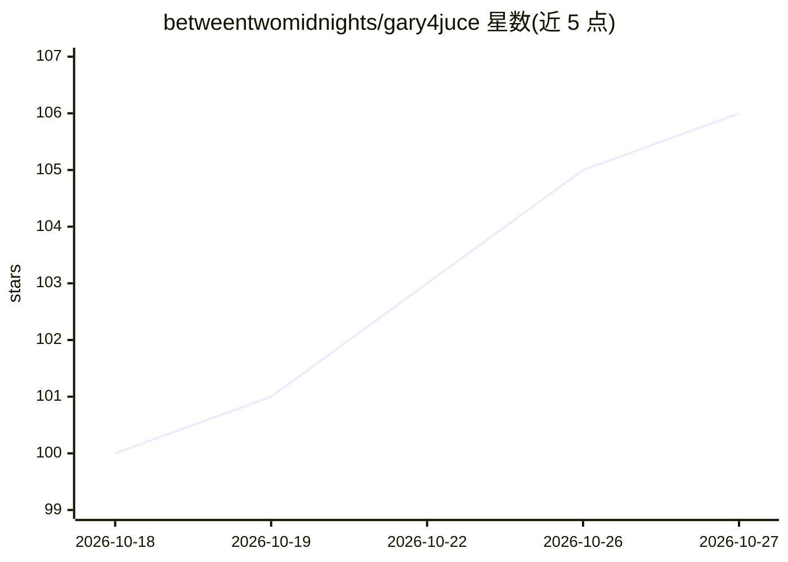

# betweentwomidnights/gary4juce

⭐ 106 · C++ · AGPL-3.0 · 推送 2026-10-26 · [GitHub](https://github.com/betweentwomidnights/gary4juce) · 个人维护

**在 DAW 内运行 8 个开源 AI 音乐模型的 VST3/AU 插件**

面向音乐人的 JUCE 插件（VST3/AU/独立应用），把 YuE2、stable-audio-3、MusicGen、stable-audio-open-small、foundation-1、ACE-Step、Melodyflow、magenta-realtime 八个模型与一个基于 stems.cpp 的本机分轨器集成进 DAW 会话，提供歌曲生成、循环生成、续写、音频变换、分轨与 MIDI 乐谱导出等操作。后端可选远程服务（DGX Spark 自托管）或本机 gary4local 服务（需 GPU，建议 10-24GB+ VRAM）。Windows/macOS 提供预编译安装包。

## 筛选速览

| 维度 | 判定 | 备注 |
|---|---|---|
| AI 角色 | `ai-native` | 本体是模型或模型工具 |
| 许可风险 | `viral` | AGPL-3.0 |
| 部署形态 | `desktop` | 安装包/桌面程序 |
| 模型依赖 | — | README 未给出锁定关系 |
| 硬件要求 | — | 无带数字的原话,不猜 |
| 安装摩擦 | `low` | 无编译、无系统依赖或容器化 |
| 成熟度 | — | 结构信号不足 |

## 能力要点

- 集成 8 个开源 AI 音乐模型（YuE2/stable-audio-3/MusicGen/ACE-Step/Melodyflow 等）
- 基于 stems.cpp 的本机分轨器，含 8 个 UVR 清理模型与 DrumSep 鼓组件分轨
- YuE2 渲染保留乐谱，可编辑、移调并作为 MIDI 拖入 DAW
- 远程后端与 localhost gary4local 本机后端两种运行方式

## 适用场景

- 在 DAW 内对录音缓冲直接做续写、变换或循环生成
- 生成带词/无词歌曲并导出可编辑的 MIDI 乐谱
- 本机拆分音轨并做降噪、去混响、鼓组件分离

## 场景标签

 · 领域:音乐制作/AI 音频工具

## 证据(README 行号)

> L35: gary4juce now gives you **eight AI music models** directly in your DAW:
> L37: - **yuey** (YuE2) - songs with or without lyrics in your tempo and key, remixes of your audio through its own trans
> L206: 1. Put gary4juce on your master track, a bus, or any track you want to listen to.

## 星数曲线

2026-10-18 100 → 2026-10-27 106（+6）

---
*卡片 v1 · prompt 1.4 · 生成 2026-10-23 · 置信度 mid · 依据 README sha `668a3a5f5844` · [字段定义](../../DATASET.md)*
