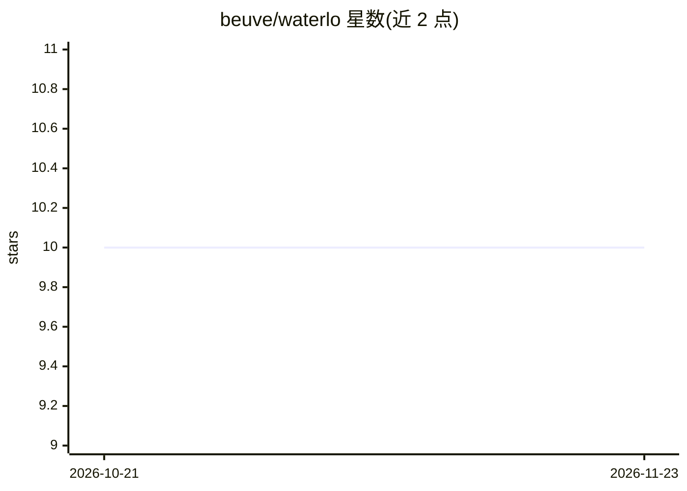

# beuve/waterlo

⭐ 10 · Python · 推送 2026-08-15 · [GitHub](https://github.com/beuve/waterlo) · 个人维护

**面向深度伪造检测的图像水印研究代码**

研究型代码库：在图像中嵌入水印，图像被 FaceSwap/FaceShifter 等方法生成换脸内容后，通过检测脚本定位被修改区域，并提供水印检测准确率评估与 PSNR 质量评估脚本。提供三种运行环境搭建方式：VS Code 远程容器、自建 Docker 容器、本地安装 Python 依赖（torch/torchvision/requirements.txt），作者注明仅在 CUDA 11.3 下测试过。面向从事水印与 deepfake 检测研究的用户，训练需自行准备按 train 目录组织的 PNG 图像数据集。

## 筛选速览

| 维度 | 判定 | 备注 |
|---|---|---|
| AI 角色 | `ai-native` | 本体是模型或模型工具 |
| 许可风险 | `none` | — |
| 部署形态 | `self-host` | docker 或自建部署 |
| 模型依赖 | — | README 未给出锁定关系 |
| 硬件要求 | — | 无带数字的原话,不猜 |
| 安装摩擦 | `low` | 无编译、无系统依赖或容器化 |
| 成熟度 | — | 结构信号不足 |

## 能力要点

- 提供水印嵌入、检测、deepfake 检测准确率评估的完整脚本流程
- 支持 mse/ssim 两种损失与可选压缩模块（--compression）
- PSNR 质量评估脚本
- 提供 Dockerfile 与 VS Code devcontainer 配置

## 适用场景

- 研究水印方法在换脸篡改后的区域定位能力
- 评估水印对图像质量（PSNR）的影响
- 搭建水印+deepfake 检测的实验基线

## 场景标签

`科研工具` · 领域:学习与行业

## 证据(README 行号)

> L44: - First, the watermark is applied using the corresponding script (located at ./scripts/apply-watermarks.sh). Some v
> L48: - Finally, the modified regions can be detected using the watermark detection script (located at ./scripts/detect-w

## 星数曲线

2026-10-21 10 → 2026-11-23 10（+0）

---
*卡片 v1 · prompt 1.4 · 生成 2026-11-19 · 置信度 high · 依据 README sha `f7b90ab5f5bf` · [字段定义](../../DATASET.md)*
