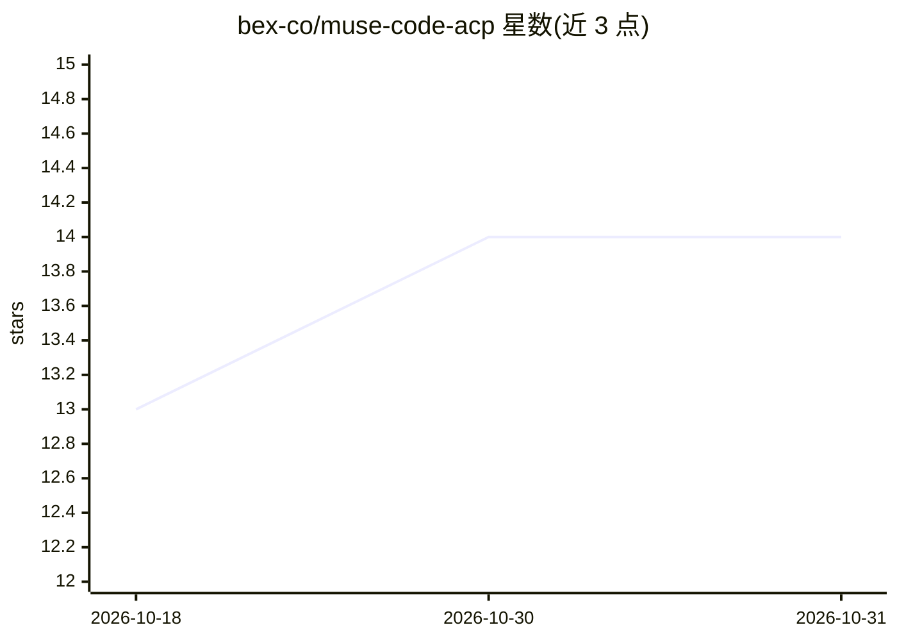

# bex-co/muse-code-acp

⭐ 14 · TypeScript · Apache-2.0 · 推送 2026-10-28 · [GitHub](https://github.com/bex-co/muse-code-acp) · 个人维护

**将 Muse Code 接入 Zed 等 ACP 编辑器的非官方适配器**

基于 TypeScript/Node 22+ 的命令行适配器，通过 ACP over stdio 把 Meta 的 Muse Code 编码代理连接到 Zed、VS Code（ACP 扩展）等 Agent Client Protocol 客户端。底层使用官方 Muse SDK（固定版本）与 muse serve（MSP）通信，提供流式回复、工具调用、会话列表/恢复/fork、Default/Read-only/Plan 模式、MCP 服务器、斜杠命令（/plan、/review、/goal 等）与权限审批路由。面向在编辑器内使用 Muse 的开发者；需另行安装 Muse 1.1.1 并通过浏览器登录或 META_API_KEY 认证。README 明确列出未实现的功能（reasoning 摘要、原生会话删除等）。

## 筛选速览

| 维度 | 判定 | 备注 |
|---|---|---|
| AI 角色 | `ai-ecosystem` | LLM/agent 周边工具 |
| 许可风险 | `permissive` | Apache-2.0 |
| 部署形态 | `library` | 以包/库形式分发 |
| 模型依赖 | — | README 未给出锁定关系 |
| 硬件要求 | — | 无带数字的原话,不猜 |
| 安装摩擦 | `low` | 无编译、无系统依赖或容器化 |
| 成熟度 | — | 结构信号不足 |

## 能力要点

- 通过 ACP over stdio 将 Muse Code 接入 Zed/VS Code 等 ACP 编辑器
- 会话管理：分页列表、完整历史加载、无重放恢复、原生 fork
- 客户端提供的 MCP 服务器（stdio + HTTP）与多阶段权限审批路由
- Default/Read-only/Plan 三种模式与 /plan、/review、/goal 等斜杠命令

## 适用场景

- 在 Zed 或 VS Code 内直接使用 Muse Code 编码代理而不切换到终端
- 在编辑器内以 Plan 模式做规划、执行 Git 审查与目标管理
- 为 Muse 会话接入客户端侧 MCP 工具服务器

## 场景标签

`编码 Agent` · 领域:编码与开发

## 证据(README 行号)

> L5: **`muse-code-acp`** connects Muse Code to Agent Client Protocol (ACP) clients like **Zed** and **VS Code with an ACP
> L119: muse-code-acp  (this adapter)

## 星数曲线

2026-10-18 13 → 2026-10-31 14（+1）

---
*卡片 v1 · prompt 1.4 · 生成 2026-10-31 · 置信度 high · 依据 README sha `6964fe7946a0` · [字段定义](../../DATASET.md)*
