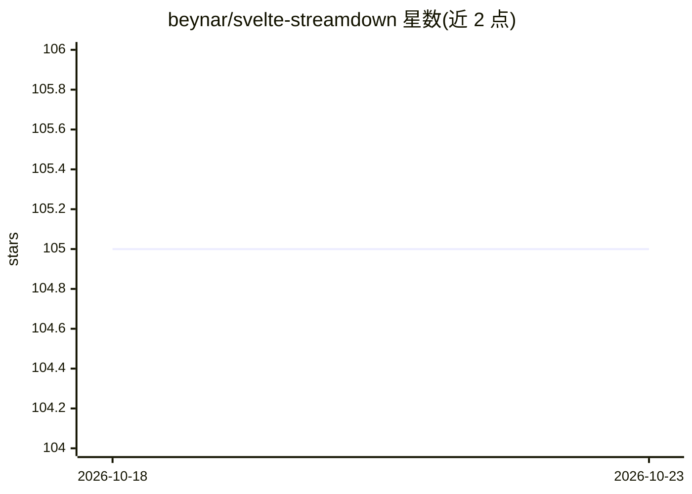

# beynar/svelte-streamdown

⭐ 105 · TypeScript · MIT · 推送 2026-10-19 · [GitHub](https://github.com/beynar/svelte-streamdown) · [官网](https://svelte-streamdown.beynar.workers.dev/) · 个人维护

**面向 AI 流式应用的 Svelte Markdown 渲染组件库**

Vercel Streamdown 的 Svelte 移植，提供 Svelte 组件用于在 AI 流式应用中渲染 Markdown 内容：支持未完结块的渐进渲染、incomplete 信号、限高自滚动代码块与表格；内建 Tailwind 排版主题、逐组件可定制 snippets 与类型安全 props。功能覆盖代码高亮（@tanstack/highlight）、KaTeX 数学（opt-in）、Mermaid 图（流式实时绘制）、复杂表格（colspan/rowspan/全屏/多格式导出）、脚注、引用弹层与 GitHub Alert 等。通过 npm/pnpm/yarn 安装。

## 筛选速览

| 维度 | 判定 | 备注 |
|---|---|---|
| AI 角色 | `ai-ecosystem` | LLM/agent 周边工具 |
| 许可风险 | `permissive` | MIT |
| 部署形态 | `self-host` | docker 或自建部署 |
| 模型依赖 | — | README 未给出锁定关系 |
| 硬件要求 | — | 无带数字的原话,不猜 |
| 安装摩擦 | `low` | 无编译、无系统依赖或容器化 |
| 成熟度 | — | 结构信号不足 |

## 能力要点

- 流式渐进渲染，未完结块优雅处理并提供 incomplete 信号
- KaTeX 数学（opt-in）与 Mermaid 图流式实时绘制
- 复杂表格：colspan/rowspan、全屏、复制导出为 Markdown/HTML/CSV/TSV
- 每个组件可用 Svelte snippets 定制，粒度化主题系统

## 适用场景

- 在 Svelte 聊天应用中流式渲染 LLM 返回的 Markdown
- 渲染包含代码块、公式、图表的 AI 生成内容
- 需要图片来源白名单与链接安全控制的渲染场景

## 场景标签

 · 领域:前端/AI 应用界面组件

## 证据(README 行号)

> L5: A **Svelte port** of Streamdown by Vercel - an all in one markdown renderer, designed specifically for AI-powered st
> L26: - **Progressive Rendering**: Perfect for streaming AI responses

## 星数曲线

2026-10-18 105 → 2026-10-23 105（+0）

---
*卡片 v1 · prompt 1.4 · 生成 2026-10-23 · 置信度 mid · 依据 README sha `97bc0451c644` · [字段定义](../../DATASET.md)*
