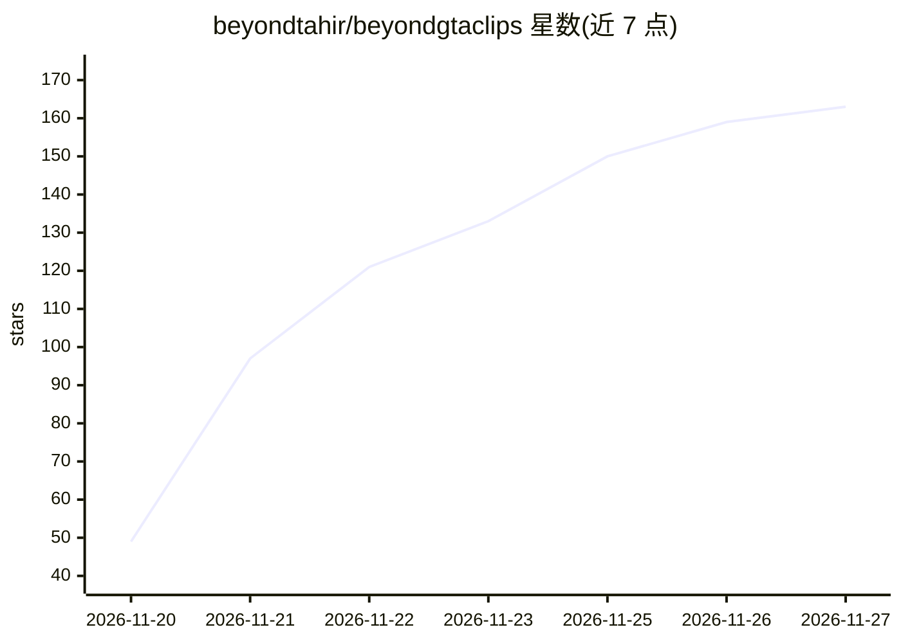

# beyondtahir/beyondgtaclips

⭐ 163 · Python · NOASSERTION · 推送 2026-11-20 · [GitHub](https://github.com/beyondtahir/beyondgtaclips) · 个人维护

**让 AI 助手自动把 GTA 6 长直播剪成 9:16 短视频**

以 AI 助手技能形式分发的视频剪辑工具：在 Claude Code、Codex 等本地助手中加载后，用户说一句话即可触发流程——搜索 YouTube 上观看量最高的 GTA 6 直播、跳过菜单与等待画面、依据尖叫/笑声/聊天峰值定位高能片段、只下载所需秒数，再剪辑为 1080×1920 的 9:16 竖屏视频，提供 Hook card 等 5 种样式、逐词字幕与 hook 文本，并生成含标题与标签的 POSTING.md。本地运行，无需 API key，依赖 ffmpeg 与 deno。

## 筛选速览

| 维度 | 判定 | 备注 |
|---|---|---|
| AI 角色 | `ai-native` | 本体是模型或模型工具 |
| 许可风险 | `none` | NOASSERTION |
| 部署形态 | `None` |  |
| 模型依赖 | — | README 未给出锁定关系 |
| 硬件要求 | — | 无带数字的原话,不猜 |
| 安装摩擦 | `medium` | 含编译或系统依赖之一 |
| 成熟度 | — | 结构信号不足 |

## 能力要点

- 自动定位高能片段并剪成 5 种样式的 9:16 reels
- story check：查看帧内容重剪片段并改写不符画面的 hook
- 每条 reel 附 2 个额外 A/B 测试 hook 与含标签的 POSTING.md
- 本地运行，无 API key、无订阅

## 适用场景

- 把 GTA 6 直播流自动剪成可投稿的短视频
- 为剪辑分成活动快速批量产出 reels
- 换成任意游戏名复用同一剪辑流程

## 场景标签

`图像视频处理` · 领域:感知与多模态

## 证据(README 行号)

> L5:  Beyond GTA Clips watches the stream for you, finds the moments that go viral
> L63: **That part is now automatic.** You answer 3 questions. Your AI assistant finds the most viewed
> L124: 1. **You say** *"Make GTA 6 clips"* to Claude or ChatGPT.

## 星数曲线

2026-11-20 49 → 2026-11-27 163（+114）

---
*卡片 v1 · prompt 1.4 · 生成 2026-11-27 · 置信度 high · 依据 README sha `6e684c6b0709` · [字段定义](../../DATASET.md)*
