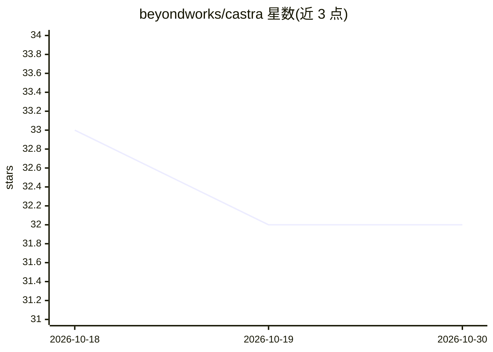

# beyondworks/castra

⭐ 32 · Python · MIT · 推送 2026-09-16 · [GitHub](https://github.com/beyondworks/castra) · 个人维护

**Claude Code 的执行姿态工作流与钩子运行时支持包**

面向 Claude Code 的工作流与运行时支持包：通过 SessionStart、UserPromptSubmit、PostToolUse、Stop 等钩子注入契约、维护会话作用域状态与检查点，并提供 run/review/verify/reframe/finish/resume 等命令模式。附带验证运行器，可将声明的文件集连接到指定检查命令并记录哈希、退出码与耗时；还包含风险语法守护与发布门禁等机制。安装需 Python 3.10+，支持 standalone 与 plugin 两种模式，插件脚本用 PATH 中的 Python 运行。不复制私有系统提示、不改模型权重；Windows/Linux 运行时行为尚未取得证据。

## 筛选速览

| 维度 | 判定 | 备注 |
|---|---|---|
| AI 角色 | `ai-ecosystem` | LLM/agent 周边工具 |
| 许可风险 | `permissive` | MIT |
| 部署形态 | `None` |  |
| 模型依赖 | — | README 未给出锁定关系 |
| 硬件要求 | — | 无带数字的原话,不猜 |
| 安装摩擦 | `low` | 无编译、无系统依赖或容器化 |
| 成熟度 | — | 结构信号不足 |

## 能力要点

- 基于 Claude Code 钩子（SessionStart/PostToolUse/Stop 等）的契约注入与状态管理
- 验证运行器：文件集关联检查命令，存储哈希/退出码/耗时与受限诊断尾部
- 状态存放于 ~/.castra/sessions/，按会话哈希隔离，不在仓库内留文件
- 含风险语法守护（Guardian）与发布门禁（Release gate）机制

## 适用场景

- 让 Claude Code 会话在中断后恢复并保留作用域状态与检查点
- 对声明文件集运行显式验证命令并留存执行证据
- 约束代理行为边界，区分源码修改与已安装/运行时产物

## 场景标签

`Agent 框架` · 领域:Agent 开发

## 证据(README 行号)

> L3: A development workflow and runtime support package for Claude Code. Castra helps a capable model carry an authorized
> L7: Use `/castra run <request>` after standalone installation, or `/castra:castra run <request>` in plugin mode. `castra
> L15: |Mechanism|Actual behavior|Limit|

## 星数曲线

2026-10-18 33 → 2026-10-30 32（-1）

---
*卡片 v1 · prompt 1.4 · 生成 2026-10-26 · 置信度 high · 依据 README sha `3bb04e11be1e` · [字段定义](../../DATASET.md)*
