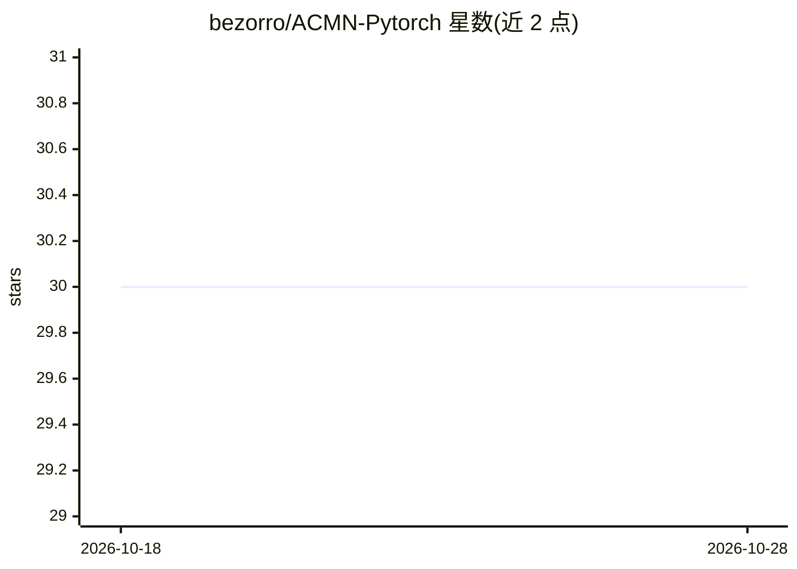

# bezorro/ACMN-Pytorch

⭐ 30 · Python · MIT · 推送 2026-02-25 · [GitHub](https://github.com/bezorro/ACMN-Pytorch) · 个人维护

**CVPR 2018 视觉问答论文 ACMN 的 PyTorch 官方实现**

论文《Visual Question Reasoning on General Dependency Tree》（CVPR 2018 Spotlight）的官方代码，实现 ACMN 模型在 CLEVR 视觉推理数据集上的训练、验证与测试。流程为：下载 CLEVR v1.0 数据集（18 GB）与预处理问题数据、提取 ResNet-101 图像特征到 h5 文件，再以 train_val.py 训练或评估；提供预训练模型下载（约 2.6 GB 磁盘占用）、test.py 生成可提交官方的结果 JSON，以及 vis.py 可视化论文 Figure 4 的注意力图。面向视觉问答方向的科研人员复现论文结果。限制：问题预处理代码标注“即将提供”，当前依赖作者提供的预处理数据。

## 筛选速览

| 维度 | 判定 | 备注 |
|---|---|---|
| AI 角色 | `ai-native` | 本体是模型或模型工具 |
| 许可风险 | `permissive` | MIT |
| 部署形态 | `None` |  |
| 模型依赖 | — | README 未给出锁定关系 |
| 硬件要求 | — | 无带数字的原话,不猜 |
| 安装摩擦 | `low` | 无编译、无系统依赖或容器化 |
| 成熟度 | — | 结构信号不足 |

## 能力要点

- 提供 CLEVR 数据集下载、问题预处理、ResNet-101 图像特征提取的完整流程脚本
- 可下载预训练模型并在 CLEVR-val 评估、CLEVR-test 生成提交结果
- vis.py 支持可视化论文 Figure 4 描述的注意力图

## 适用场景

- 复现 CVPR 2018 论文的 CLEVR 视觉问答结果
- 在 CLEVR 数据集上训练 ACMN 模型并生成官方测试提交
- 可视化模型注意力图用于分析

## 场景标签

`科研工具` · 领域:学习与行业

## 证据(README 行号)

> L1: # Visual Question Reasoning on General Dependency Tree
> L5: This is the code for the paper on CLEVR
> L15:  Presented at CVPR 2018 (Spotlight Presentation)

## 星数曲线

2026-10-18 30 → 2026-10-28 30（+0）

---
*卡片 v1 · prompt 1.4 · 生成 2026-10-26 · 置信度 mid · 依据 README sha `a0d50f60d2f4` · [字段定义](../../DATASET.md)*
