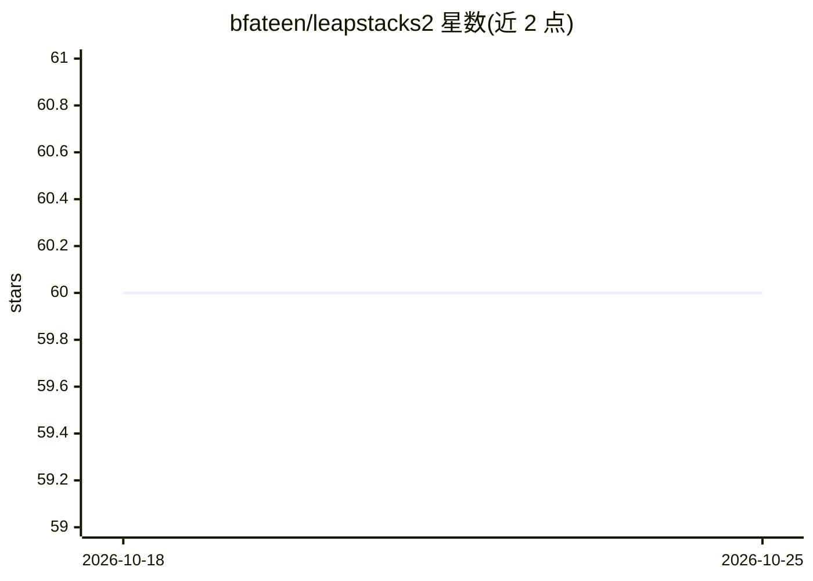

# bfateen/leapstacks2

⭐ 60 · 推送 2026-02-22 · [GitHub](https://github.com/bfateen/leapstacks2) · 个人维护

**向自有 AWS 账号一键部署 AI agent/RAG/聊天应用的模板集**

面向缺乏 AWS 经验的 Web 开发者的基础设施即代码模板集：通过单个 CloudFormation 部署在数分钟内将 12 个全栈原型（n8n 自动化、语音 agent、RAG 知识库、聊天机器人等）安装到用户自有 AWS 账号。栈可独立运行或像乐高一样互相组合；支持在 20+ 基础模型间切换，提供每条消息成本、token 用量、延迟的实时观测，含可选的 2 小时自动清理以控制费用。MIT 许可，由个人开发者及多名贡献者维护。

## 筛选速览

| 维度 | 判定 | 备注 |
|---|---|---|
| AI 角色 | `ai-ecosystem` | LLM/agent 周边工具 |
| 许可风险 | `none` | — |
| 部署形态 | `None` |  |
| 模型依赖 | — | README 未给出锁定关系 |
| 硬件要求 | — | 无带数字的原话,不猜 |
| 安装摩擦 | `low` | 无编译、无系统依赖或容器化 |
| 成熟度 | — | 结构信号不足 |

## 能力要点

- 12 个预构建全栈原型，单个 CloudFormation 一键部署，无需 CLI/CDK/Terraform
- 实时观测：每条消息成本、token 用量、延迟与请求日志
- 可在 20+ 基础模型（含 Claude Sonnet 4.5、Amazon Nova Pro）间切换
- 可选 2 小时自动清理定时器控制实验成本

## 适用场景

- 把本地 AI 原型快速部署到生产形态的 AWS 环境
- 学习真实运行系统中的 agent 行为、成本与延迟
- 组合多个栈搭建更大的 Web 应用并导出到 GitHub 二次开发

## 场景标签

`工作流自动化` `聊天机器人` `RAG` · 领域:效率与自动化

## 证据(README 行号)

> L5: Deploy production-ready **AI agents, RAG systems, and full-stack chatbots** to your **own AWS account in minutes** —
> L15: **LEAP Stacks 2 bridges this gap** by providing **infrastructure-as-code** templates that install **directly into y
> L53: |**Agentic Automation (n8n)**|Fully hosted n8n for visual AI workflow automation|

## 星数曲线

2026-10-18 60 → 2026-10-25 60（+0）

---
*卡片 v1 · prompt 1.4 · 生成 2026-10-24 · 置信度 high · 依据 README sha `d75a3b7ab7f7` · [字段定义](../../DATASET.md)*
