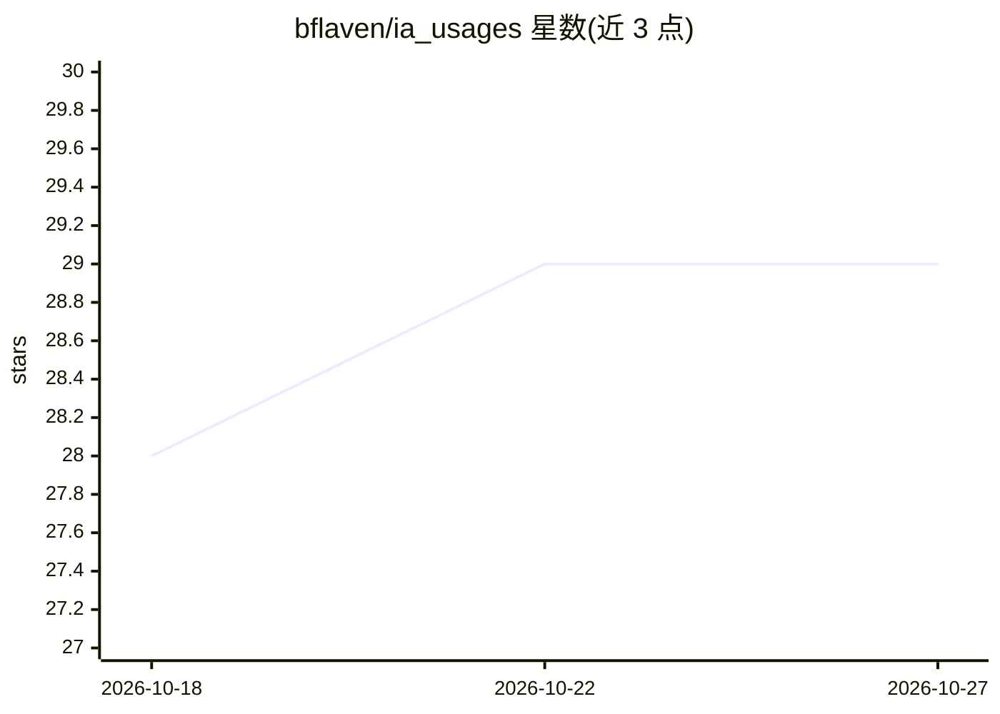

# bflaven/ia_usages

⭐ 29 · Python · 推送 2026-09-15 · [GitHub](https://github.com/bflaven/ia_usages) · [官网](https://flaven.fr/) · 个人维护

**AI 应用实践博文与案例聚合仓库，记录 DENIA 项目设计思考**

汇集作者关于 AI 应用的 20+ 篇博文的索引仓库，主题覆盖 FastAPI 部署 NLP/ML 模型、Whisper 语音转写、NLLB 翻译、Ollama/LM Studio 本地 LLM、LLM 质量与提示工程等，并附 YouTube 视频列表。仓库同时记录其背后 DENIA 项目（France Médias Monde 的多语言内容 AI 微服务编排器，基于 Mistral 7B，支持切换到付费 API）的设计思考。内容以文章链接为主，代码片段仅含 Git 命令备忘。

## 筛选速览

| 维度 | 判定 | 备注 |
|---|---|---|
| AI 角色 | `ai-knowledge` | 知识聚合/清单类 |
| 许可风险 | `none` | — |
| 部署形态 | `None` |  |
| 模型依赖 | — | README 未给出锁定关系 |
| 硬件要求 | — | 无带数字的原话,不猜 |
| 安装摩擦 | `low` | 无编译、无系统依赖或容器化 |
| 成熟度 | — | 结构信号不足 |

## 能力要点

- 20+ 篇 AI 应用实践博文索引（FastAPI/Spacy/Whisper/NLLB/Ollama 等）
- DENIA 多语言 AI 微服务编排器的设计背景说明
- 配套 YouTube 视频播放列表

## 适用场景

- 查找 FastAPI 部署 ML/NLP 模型的实践参考
- 了解媒体机构多语言 AI 编排系统的落地案例
- 按主题浏览 LLM、提示工程与本地推理相关文章

## 场景标签

`精选清单` · 领域:学习与行业

## 证据(README 行号)

> L26: **All the latest posts dedicated to artificial intelligence usages are brought together in this repository for conv
> L30: 1. POC with FastAPI for an NLP API with Spacy, SQLAlchemy, Sqlite and… Streamlit. https://flaven.fr/2023/10/poc-wit

## 星数曲线

2026-10-18 28 → 2026-10-27 29（+1）

---
*卡片 v1 · prompt 1.4 · 生成 2026-10-26 · 置信度 high · 依据 README sha `d272f65a17ba` · [字段定义](../../DATASET.md)*
