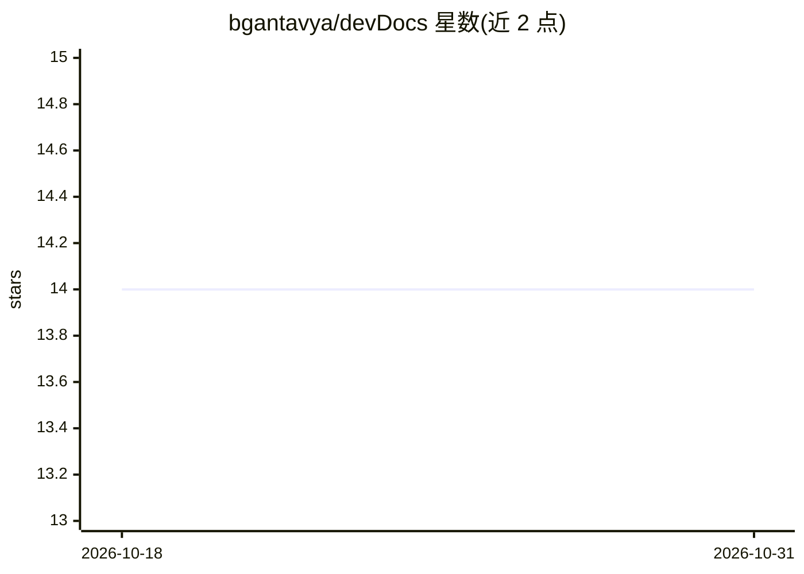

# bgantavya/devDocs

⭐ 14 · Python · 推送 2026-04-01 · [GitHub](https://github.com/bgantavya/devDocs) · [官网](https://pypi.org/project/devDocs/) · 个人维护

**给开发者的 CLI 工具：用 Gemini 自动生成项目 README**

Python 命令行工具 devDocs：扫描项目目录与源码文件，解析代码、注释与既有文档，调用 Google Gemini API 生成结构化 README.md，保存到指定输出目录（默认 docs/）。支持通过 --include/--exclude 细粒度控制扫描范围、--overwrite 覆盖原文件、生成目录树。需 Python 3.8+ 与 Gemini API Key，pip 安装，运行时需联网。限制：重试逻辑简单、过滤器不支持正则、仅输出 Markdown 格式。

## 筛选速览

| 维度 | 判定 | 备注 |
|---|---|---|
| AI 角色 | `ai-native` | 本体是模型或模型工具 |
| 许可风险 | `none` | — |
| 部署形态 | `library` | 以包/库形式分发 |
| 模型依赖 | — | README 未给出锁定关系 |
| 硬件要求 | — | 无带数字的原话,不猜 |
| 安装摩擦 | `low` | 无编译、无系统依赖或容器化 |
| 成熟度 | — | 结构信号不足 |

## 能力要点

- 扫描项目结构/源码/既有文档并生成 README.md
- --include/--exclude 细粒度文件过滤
- 默认不覆盖原文件，需 --overwrite 显式开启
- 调用 Google Gemini API 生成内容

## 适用场景

- 开源贡献者为项目快速生成 README
- 黑客松项目在短时间内补齐文档
- 内部开发工具项目批量产出初始文档

## 场景标签

`AI 写作` · 领域:内容生成

## 证据(README 行号)

> L3: `devDocs` is a command-line tool that automatically generates clean, professional `README.md` files by analyzing you
> L26: 3. **Generates** documentation via Google Gemini

## 星数曲线

2026-10-18 14 → 2026-10-31 14（+0）

---
*卡片 v1 · prompt 1.4 · 生成 2026-10-31 · 置信度 high · 依据 README sha `0bdace6c786d` · [字段定义](../../DATASET.md)*
