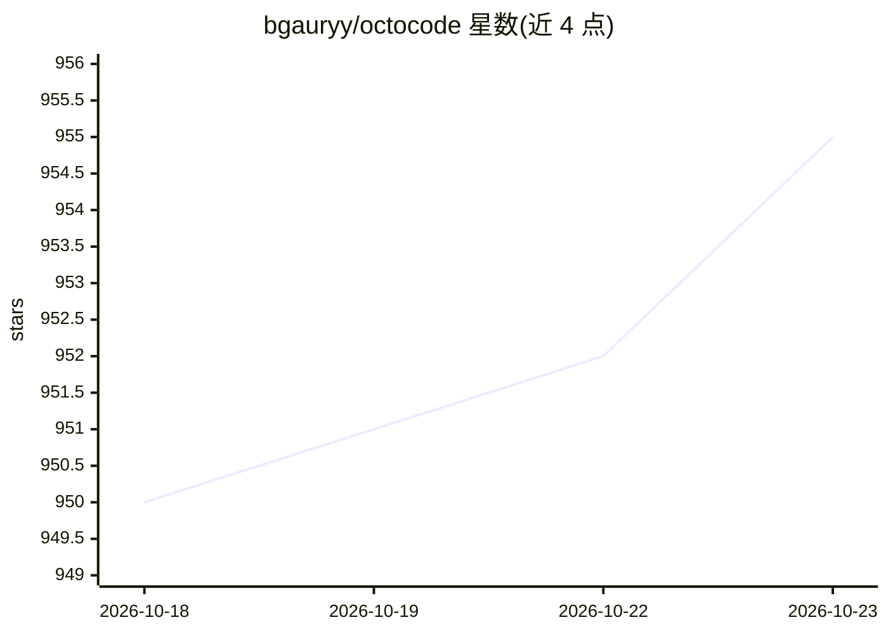

# bgauryy/octocode

⭐ 955 · TypeScript · MIT · 推送 2026-10-21 · [GitHub](https://github.com/bgauryy/octocode) · [官网](https://octocode.ai/) · 个人维护

**面向 AI 代理与开发者的代码研究工具集（CLI/MCP）**

以同一套工具集研究本地代码与外部代码（GitHub 仓库、PR、npm），底层为预编译的 Rust 引擎，提供 ripgrep+AST 搜索、目录树浏览、精确区域读取、LSP 语义导航、代码压缩/骨架化与克隆功能。可作为 CLI 或 MCP 服务器使用，共 17 个工具（MCP 默认注册 8 个，按 flag 扩展）。面向希望以低 token 消耗获取可引用代码上下文的 AI 编码代理与开发者；需 Node.js 20.12+，GitHub 认证可选。

## 筛选速览

| 维度 | 判定 | 备注 |
|---|---|---|
| AI 角色 | `ai-ecosystem` | LLM/agent 周边工具 |
| 许可风险 | `permissive` | MIT |
| 部署形态 | `library` | 以包/库形式分发 |
| 模型依赖 | — | README 未给出锁定关系 |
| 硬件要求 | — | 无带数字的原话,不猜 |
| 安装摩擦 | `low` | 无编译、无系统依赖或容器化 |
| 成熟度 | — | 结构信号不足 |

## 能力要点

- 本地与 GitHub/npm 代码统一工具集，Rust 引擎驱动
- 17 个工具：代码搜索、AST 结构匹配、LSP 语义导航、死代码分析等
- CLI 与 MCP 双界面，每个 MCP 工具同为普通命令（JSON 入、YAML 出）
- 按 flag 控制工具注册与 token 密度（concise/minify 分级）

## 适用场景

- 让编码代理在改代码前先获取带文件/行锚点的证据型上下文
- 跨仓库对比实现模式、追踪 PR 与提交历史
- 对大型文件做压缩/骨架化读取以节省 token

## 场景标签

 · 领域:开发者工具/代码智能

## 证据(README 行号)

> L14: Octocode researches **your local code and external code alike** (GitHub repositories, PRs, npm) with one toolset: r
> L60: claude mcp add-json octocode --scope user '{"command":"npx","type":"stdio","args":["octocode-mcp@latest"]}'
> L210: The MCP server exposes the Octocode tool catalog directly to your AI assistant over stdio.

## 星数曲线

2026-10-18 950 → 2026-10-23 955（+5）

---
*卡片 v1 · prompt 1.4 · 生成 2026-10-21 · 置信度 high · 依据 README sha `72d668a5b6e3` · [字段定义](../../DATASET.md)*
