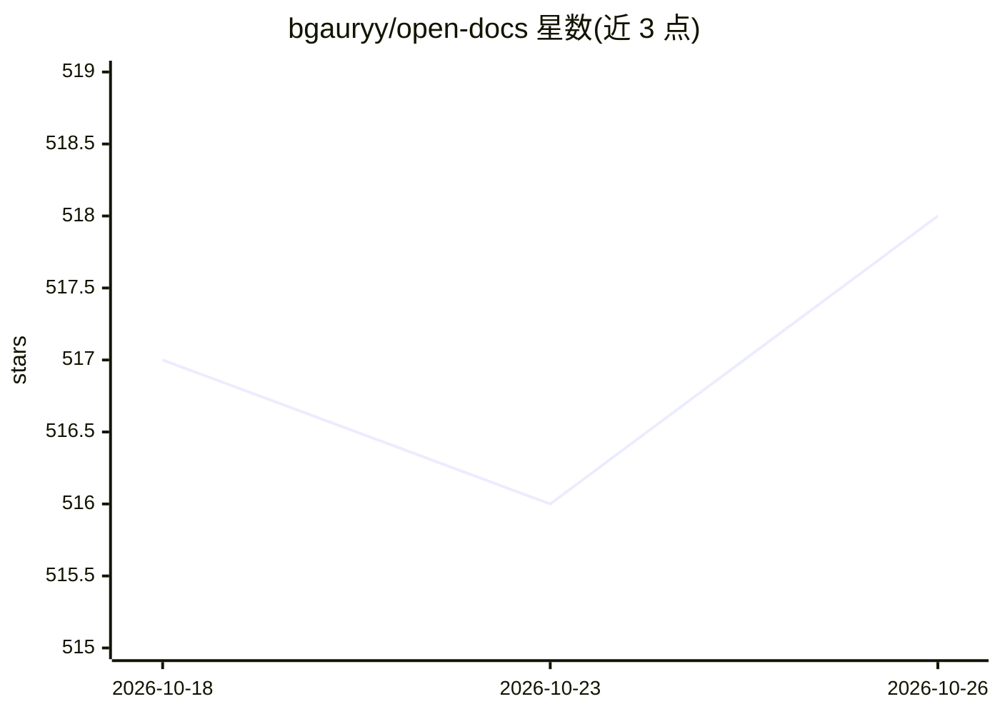

# bgauryy/open-docs

⭐ 518 · 推送 2026-01-20 · [GitHub](https://github.com/bgauryy/open-docs) · 个人维护

**AI CLI 编码工具的逆向深读文档库：解析架构与未文档化细节**

由 Octocode 维护的文档仓库，从开源代码中提取 Claude Agent SDK、Gemini CLI、Codex CLI、OpenCode、Pi Coding Agent 五款 AI 编码代理的深读文档：内部架构、未公开 API 与系统提示词、安全模型与边界情况、集成模式。面向需要了解工具底层实现并基于其二次构建的开发者、研究者与高级用户。内容声明仅供研究与教育用途，不提供担保；另提供面向企业的内部文档定制联系方式。

## 筛选速览

| 维度 | 判定 | 备注 |
|---|---|---|
| AI 角色 | `ai-knowledge` | 知识聚合/清单类 |
| 许可风险 | `none` | — |
| 部署形态 | `None` |  |
| 模型依赖 | — | README 未给出锁定关系 |
| 硬件要求 | — | 无带数字的原话,不猜 |
| 安装摩擦 | `low` | 无编译、无系统依赖或容器化 |
| 成熟度 | — | 结构信号不足 |

## 能力要点

- 覆盖 5 款 AI 编码代理（Claude Agent SDK、Gemini CLI、Codex CLI、OpenCode、Pi）
- 提取未文档化功能：隐藏 API、beta 功能、系统提示词
- 记录安全模型、权限模式与实现约束
- 通过 issue 接受新的分析请求

## 适用场景

- 为基于 Claude Agent SDK 或 Gemini CLI 的开发了解内部机制
- 查找官方文档未覆盖的隐藏 API 与集成模式
- 研究 AI 编码代理的沙箱与安全策略实现

## 场景标签

`精选清单` · 领域:学习与行业

## 证据(README 行号)

> L4: > **The missing manual for AI CLI tools.**
> L10: Open source doesn't always mean well-documented. Critical details are often buried in code. We extract:

## 星数曲线

2026-10-18 517 → 2026-10-26 518（+1）

---
*卡片 v1 · prompt 1.4 · 生成 2026-10-22 · 置信度 high · 依据 README sha `b5090588cd1c` · [字段定义](../../DATASET.md)*
