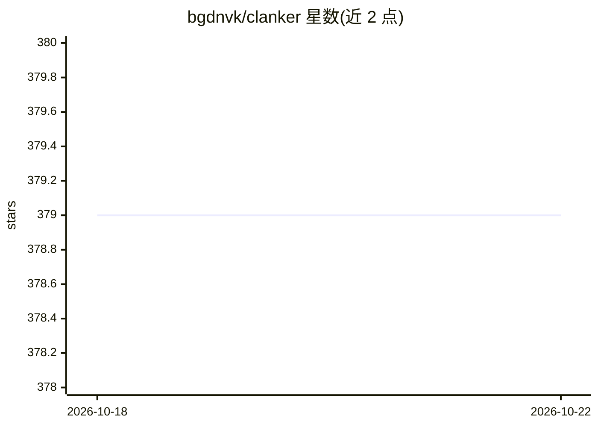

# bgdnvk/clanker

⭐ 379 · Go · MIT · 推送 2026-10-18 · [GitHub](https://github.com/bgdnvk/clanker) · [官网](https://clankercloud.ai/) · 个人维护

**面向多云环境的自主系统工程 CLI 代理**

开源基础设施 CLI，属 Clanker Cloud 云运维工作流的终端部分：通过 AI 对话（ask）检查 AWS/GCP/Azure/Cloudflare 等现有环境，经 maker 流程生成基础设施执行计划（JSON）并可用 --apply 应用。复用本地云商 CLI 凭证（如 AWS CLI profile/SSO），支持 OpenAI/Gemini/Cohere 作为 AI 后端，自带 MCP 服务（含 Kubernetes 管理工具集），可部署单文件 HTML 应用到 Clanker Cloud，并提供 onboarding 扫描检测缺失的云商 CLI。

## 筛选速览

| 维度 | 判定 | 备注 |
|---|---|---|
| AI 角色 | `ai-native` | 本体是模型或模型工具 |
| 许可风险 | `permissive` | MIT |
| 部署形态 | `None` |  |
| 模型依赖 | locked-api |  |
| 硬件要求 | — | 无带数字的原话,不猜 |
| 安装摩擦 | `medium` | 含编译或系统依赖之一 |
| 成熟度 | — | 结构信号不足 |

## 能力要点

- 多云资源清点与只读 list 命令（AWS/GCP/Azure/Cloudflare 等）
- maker/deploy 流程生成并应用基础设施执行计划
- 内建 MCP 服务，暴露 20+ 工具含 Kubernetes 原生管理
- onboarding scan 检测本地凭证与缺失的云商 CLI

## 适用场景

- 在终端用自然语言查询和检查云基础设施状态
- 生成并应用跨云商的基础设施变更计划
- 通过 MCP 把云运维与 Kubernetes 管理能力接入 agent 客户端

## 场景标签

 · 领域:云运维/基础设施自动化

## 证据(README 行号)

> L15: Ask questions about your infra (and optionally GitHub/etc). Clanker can inspect existing environments and also gene
> L5: Open-source infrastructure CLI for Clanker DevOps, the cloud-operations workflow within Clanker Cloud.
> L342: - `--maker`: generate a provider execution plan (JSON) for infrastructure changes

## 星数曲线

2026-10-18 379 → 2026-10-22 379（+0）

---
*卡片 v1 · prompt 1.4 · 生成 2026-10-21 · 置信度 high · 依据 README sha `7a5ee2376faa` · [字段定义](../../DATASET.md)*
