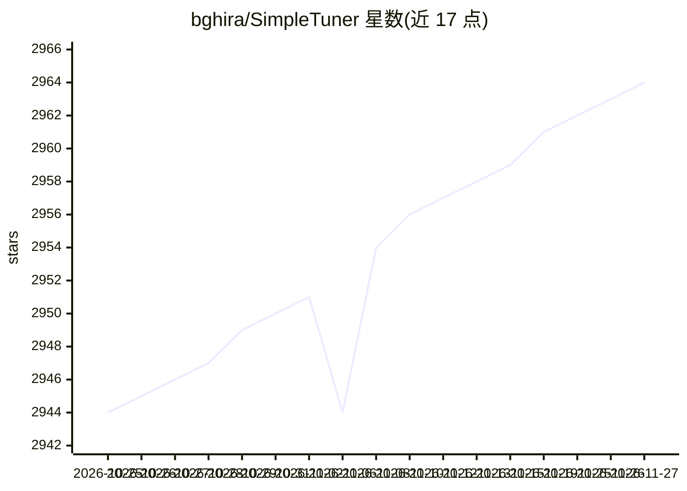

# bghira/SimpleTuner

⭐ 2,964 · Python · AGPL-3.0 · 推送 2026-11-26 · [GitHub](https://github.com/bghira/SimpleTuner) · 组织维护

**面向图像/视频/音频扩散模型的通用微调工具包**

SimpleTuner 是一个针对图像、视频、音频扩散生成模型的微调训练工具包，提供 Web UI 管理训练生命周期、命令行教程与 Quick Start 流程。支持多 GPU 分布式训练、DeepSpeed/FSDP2 分片、嵌入缓存、宽高比分桶、S3 云存储直读训练，以及 LoRA/LyCORIS 等训练方式。文档列出 30 余个支持的模型家族及其许可信息，并提供多用户企业特性（Worker 编排、SSO、RBAC、配额、审批与审计）。多数模型可在 24G 显存 GPU 上训练。

## 筛选速览

| 维度 | 判定 | 备注 |
|---|---|---|
| AI 角色 | `ai-ecosystem` | LLM/agent 周边工具 |
| 许可风险 | `dual` | AGPL-3.0 |
| 部署形态 | `library` | 以包/库形式分发 |
| 模型依赖 | — | README 未给出锁定关系 |
| 硬件要求 | — | 无带数字的原话,不猜 |
| 安装摩擦 | `low` | 无编译、无系统依赖或容器化 |
| 成熟度 | — | 结构信号不足 |

## 能力要点

- 统一管线支持图像、视频、音频三类生成模型的训练
- 多 GPU 分布式训练与 DeepSpeed/FSDP2 优化器状态卸载
- 支持 30 余个扩散模型家族（Flux、SD3/SDXL、Wan Video、Qwen Image 等）
- 多用户训练平台：Worker 编排、SSO、RBAC、配额与审批工作流

## 适用场景

- 为自有数据集微调 Flux、SDXL 等图像扩散模型
- 训练文生视频模型（Wan、LTX、Hunyuan Video）
- 在 16-24G 显存设备上通过内存优化训练较大模型
- 团队内搭建多用户 GPU 训练平台并按角色配额管理

## 场景标签

`微调` · 领域:训练与推理

## 证据(README 行号)

> L32: SimpleTuner provides comprehensive training support across multiple diffusion model architectures with consistent f
> L37: - **Multi-modal training** - Unified pipeline for **Image, Video, and Audio** generative models
> L68: SimpleTuner supports the following model families. Detailed training feature support lives in the Quickstart Guide.

## 星数曲线

2026-10-25 2,944 → 2026-11-27 2,964（+20）

---
*卡片 v1 · prompt 1.4 · 生成 2026-11-24 · 置信度 high · 依据 README sha `f9399bd4fe1f` · [字段定义](../../DATASET.md)*
