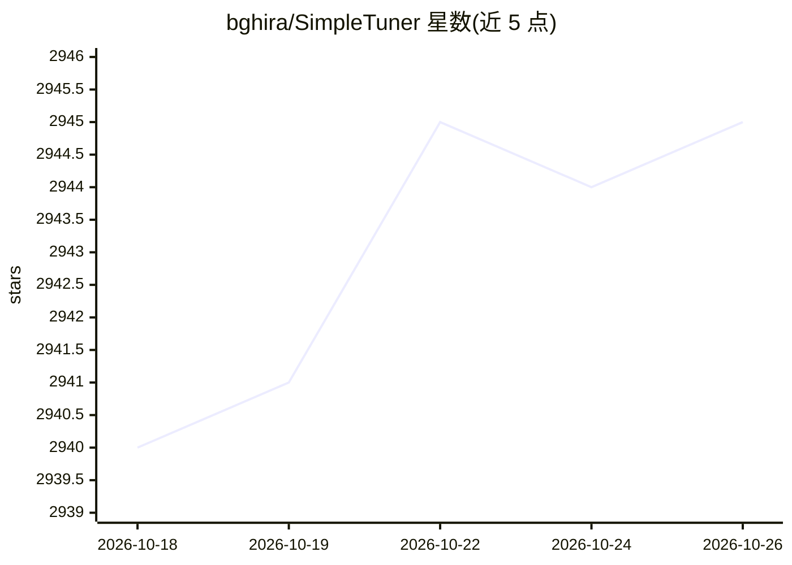

# bghira/SimpleTuner

⭐ 2,945 · Python · AGPL-3.0 · 推送 2026-10-22 · [GitHub](https://github.com/bghira/SimpleTuner) · 组织维护

**面向图像/视频/音频扩散模型的通用微调工具包**

基于 Diffusers 生态的扩散模型训练工具包，为图像、视频、音频生成模型提供统一的 LoRA/LyCORIS/全参数微调管线，支持 40 余个模型家族（Flux、SD3/SDXL、Qwen Image、Wan、Hunyuan 等）。核心机制包括 Web UI 训练管理、多 GPU 分布式训练、DeepSpeed/FSDP2 显存优化（多数模型 24G 显存可训、优化后可至 16G）、宽高比分桶、嵌入缓存与 S3 云存储直训。另含多用户企业功能：Worker 编排、SSO、RBAC、配额与审批流。以 Python 包形式通过 pip 安装，默认不向第三方发送数据。

## 筛选速览

| 维度 | 判定 | 备注 |
|---|---|---|
| AI 角色 | `ai-ecosystem` | LLM/agent 周边工具 |
| 许可风险 | `dual` | AGPL-3.0 |
| 部署形态 | `library` | 以包/库形式分发 |
| 模型依赖 | — | README 未给出锁定关系 |
| 硬件要求 | — | 无带数字的原话,不猜 |
| 安装摩擦 | `low` | 无编译、无系统依赖或容器化 |
| 成熟度 | — | 结构信号不足 |

## 能力要点

- 图像/视频/音频多模态统一微调管线，支持 40+ 模型家族
- Web UI 管理训练全生命周期，含 CaptionFlow 数据集打标集成
- DeepSpeed/FSDP2 分片与优化器卸载，多数模型 24G 显存可训
- 多用户训练平台：Worker 编排、SSO/LDAP/OIDC、RBAC、配额与审批工作流

## 适用场景

- 对 Flux/SDXL/Qwen Image 等扩散模型做 LoRA 或全参数微调
- 在有限显存下用 DeepSpeed/FSDP2 训练大模型
- 团队共享 GPU 资源并按配额/审批管理训练任务
- 直接从 S3 兼容云存储读取数据集进行训练

## 场景标签

`微调` · 领域:训练与推理

## 证据(README 行号)

> L32: SimpleTuner provides comprehensive training support across multiple diffusion model architectures with consistent f
> L37: - **Multi-modal training** - Unified pipeline for **Image, Video, and Audio** generative models
> L51: SimpleTuner includes a complete multi-user training platform with enterprise-grade features—**free and open source,

## 星数曲线

2026-10-18 2,940 → 2026-10-26 2,945（+5）

---
*卡片 v1 · prompt 1.4 · 生成 2026-10-21 · 置信度 high · 依据 README sha `d5cdaf48bbaf` · [字段定义](../../DATASET.md)*
