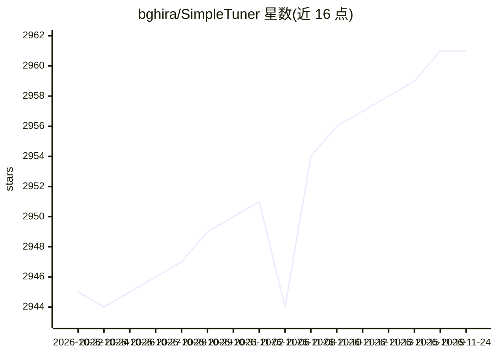

# bghira/SimpleTuner

⭐ 2,961 · Python · AGPL-3.0 · 推送 2026-11-22 · [GitHub](https://github.com/bghira/SimpleTuner) · 个人维护

**面向图像/视频/音频扩散模型的微调训练工具包**

以简化为设计目标的扩散模型微调代码库，覆盖 30+ 模型家族（Flux、SD3/SDXL、Qwen Image、Wan Video、ACE-Step 等）的图像、视频与音频生成模型训练，支持 LoRA/LyCORIS/全量微调、多 GPU 分布式训练、DeepSpeed/FSDP2 显存优化、S3 云存储训练，并提供 Web UI 管理训练生命周期。企业功能包括多用户 Worker 编排、SSO、RBAC、配额与审批流。通过 PyPI 安装，另附各模型专属 Quickstart 指南。

## 筛选速览

| 维度 | 判定 | 备注 |
|---|---|---|
| AI 角色 | `ai-ecosystem` | LLM/agent 周边工具 |
| 许可风险 | `dual` | AGPL-3.0 |
| 部署形态 | `library` | 以包/库形式分发 |
| 模型依赖 | — | README 未给出锁定关系 |
| 硬件要求 | `cpu-ok` | |
| 安装摩擦 | `low` | 无编译、无系统依赖或容器化 |
| 成熟度 | — | 结构信号不足 |

## 能力要点

- 统一管线训练图像/视频/音频三类生成模型（30+ 模型家族支持表）
- 多 GPU 训练与 DeepSpeed/FSDP2 分片，多数模型可在 24G GPU 训练、部分 16G
- 多用户训练平台：Worker 编排、SSO（LDAP/OIDC）、RBAC、配额与审批工作流
- 高级训练技术：TREAD、masked loss、Min-SNR、AnyFlow 蒸馏、CREPA

## 适用场景

- 为自有数据集微调 Flux/SDXL/Qwen Image 等图像生成模型
- 训练 Wan Video/LTX Video 等视频扩散模型
- 用 ACE-Step 训练文本到音乐的音乐生成模型
- 搭建多用户/多团队的集中式 GPU 训练平台

## 场景标签

`微调` · 领域:训练与推理

## 证据(README 行号)

> L32: SimpleTuner provides comprehensive training support across multiple diffusion model architectures with consistent f
> L37: - **Multi-modal training** - Unified pipeline for **Image, Video, and Audio** generative models
> L66: ### Model Architecture Support

## 星数曲线

2026-10-22 2,945 → 2026-11-24 2,961（+16）

---
*卡片 v1 · prompt 1.4 · 生成 2026-11-23 · 置信度 high · 依据 README sha `da9058dc1046` · [字段定义](../../DATASET.md)*
