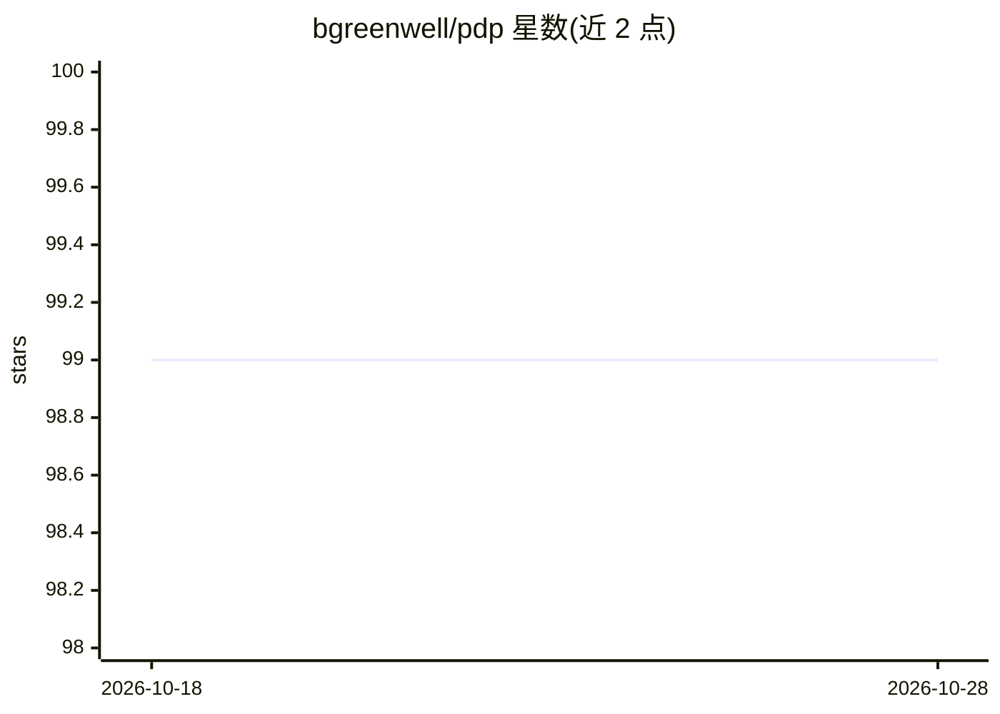

# bgreenwell/pdp

⭐ 99 · R · 推送 2026-10-08 · [GitHub](https://github.com/bgreenwell/pdp) · [官网](http://bgreenwell.github.io/pdp) · 个人维护

**R 语言模型解释包：绘制部分依赖图（PDP）与 ICE 曲线**

R 包 pdp 用于对已拟合的机器学习模型绘制部分依赖图（PDP）与个体条件期望（ICE/c-ICE）曲线，展示预测对特征子集的依赖关系。模型无关设计，开箱支持 randomForest、ranger、gbm、xgboost、caret、e1071 等数十种模型类，并可经用户自定义预测函数 pred.fun 接入任意模型。支持回归与分类、批处理预测、foreach 并行与训练数据子采样；仅依赖 lattice 与 tinyplot。因 CRAN 政策原因已从 CRAN 下架，改经 r-universe 分发。

## 筛选速览

| 维度 | 判定 | 备注 |
|---|---|---|
| AI 角色 | `ai-ecosystem` | LLM/agent 周边工具 |
| 许可风险 | `none` | — |
| 部署形态 | `None` |  |
| 模型依赖 | — | README 未给出锁定关系 |
| 硬件要求 | — | 无带数字的原话,不猜 |
| 安装摩擦 | `low` | 无编译、无系统依赖或容器化 |
| 成熟度 | — | 结构信号不足 |

## 能力要点

- 模型无关：内置支持数十种模型类，任意模型可经 pred.fun 接入
- PDP 与 ICE/c-ICE 曲线，覆盖回归与分类
- 批处理预测、foreach 并行、训练数据子采样（frac）加速
- 依赖极少：仅 lattice 与 tinyplot

## 适用场景

- 解释黑箱模型的特征效应方向与形状
- 对比不同样本的个体条件期望（ICE）曲线
- 模型诊断与结果可视化报告

## 场景标签

 · 领域:机器学习/模型可解释性

## 证据(README 行号)

> L8: Partial dependence plots (PDPs) and individual conditional expectation (ICE)
> L12: - **Model-agnostic** — works with dozens of model classes out of the box

## 星数曲线

2026-10-18 99 → 2026-10-28 99（+0）

---
*卡片 v1 · prompt 1.4 · 生成 2026-10-23 · 置信度 high · 依据 README sha `09545ba99fc2` · [字段定义](../../DATASET.md)*
