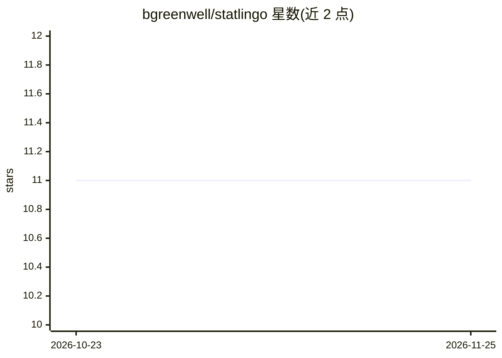

# bgreenwell/statlingo

⭐ 11 · R · 推送 2026-07-10 · [GitHub](https://github.com/bgreenwell/statlingo) · [官网](https://bgreenwell.github.io/statlingo/) · 个人维护

**R/Python 库：用 LLM 解释统计模型输出**

monorepo 包含 R 与 Python 两个包，共享同一套 LLM 提示词：读取统计模型的系数、p 值、模型拟合指标等输出，生成语境化的自然语言解释。R 包通过 ellmer 调用 LLM，Python 包通过 chatlas。R 包经 r-universe 与 GitHub 分发（曾以 statlingua 名义发布于 CRAN，未再以此名重提），Python 包发布于 PyPI。提示词集中存放于 prompts/ 目录作为单一来源，可用脚本同步再生。仓库标注生命周期为实验性。

## 筛选速览

| 维度 | 判定 | 备注 |
|---|---|---|
| AI 角色 | `ai-native` | 本体是模型或模型工具 |
| 许可风险 | `none` | — |
| 部署形态 | `library` | 以包/库形式分发 |
| 模型依赖 | — | README 未给出锁定关系 |
| 硬件要求 | — | 无带数字的原话,不猜 |
| 安装摩擦 | `low` | 无编译、无系统依赖或容器化 |
| 成熟度 | — | 结构信号不足 |

## 能力要点

- R 与 Python 双语言包，分别经 ellmer 与 chatlas 接入 LLM
- 共享单一来源的提示词目录，支持受众、详细程度与输出风格配置
- R 包经 r-universe 安装，Python 包经 PyPI 安装

## 适用场景

- 解释回归模型的系数与 p 值含义
- 教学中帮助学生理解统计软件输出
- 在数据分析流程中生成模型结果的通俗描述

## 场景标签

`数据分析` `科研工具` · 领域:效率与自动化

## 证据(README 行号)

> L11: **statlingo** translates the dense output of statistical models—coefficients,
> L13: language explanations using Large Language Models (LLMs).

## 星数曲线

2026-10-23 11 → 2026-11-25 11（+0）

---
*卡片 v1 · prompt 1.4 · 生成 2026-11-18 · 置信度 high · 依据 README sha `3dcd7124534d` · [字段定义](../../DATASET.md)*
