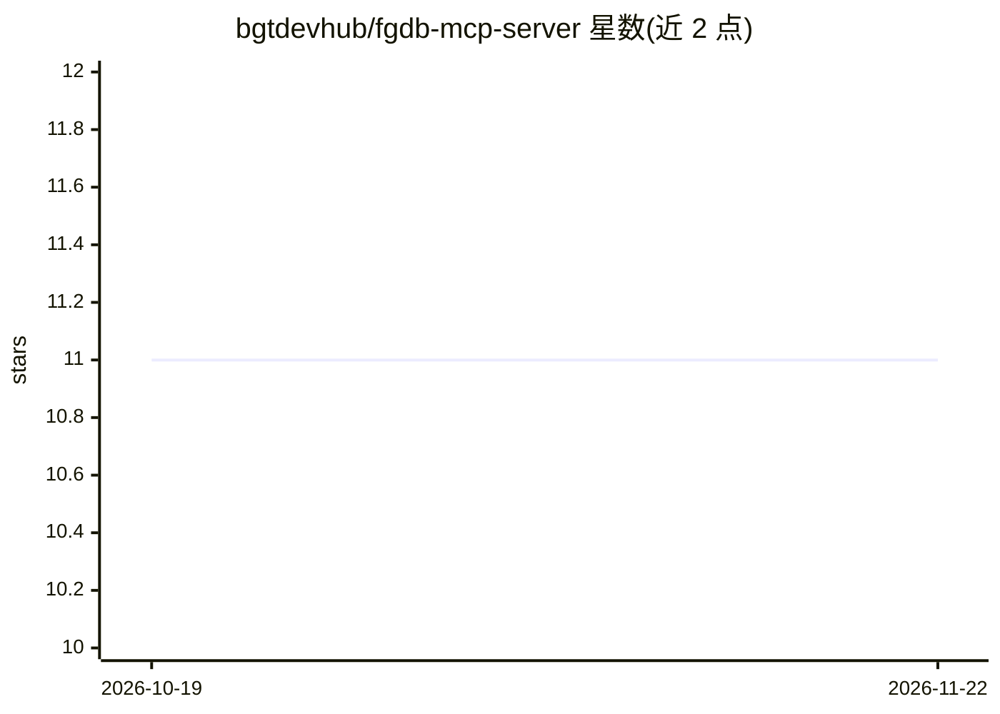

# bgtdevhub/fgdb-mcp-server

⭐ 11 · Python · MIT · 推送 2026-04-09 · [GitHub](https://github.com/bgtdevhub/fgdb-mcp-server) · 个人维护

**让 AI 助手通过 MCP 查询和修改 Esri 地理数据库的服务器**

基于 MCP 协议的服务器，通过 ArcPy 连接 Esri 文件地理数据库（FGDB）和企业地理数据库（SDE 连接文件），提供 13 个 MCP 工具，覆盖数据查询（含 SQL 过滤与分页）、增删改、字段/域管理与元数据操作。内置分级安全系统：中高风险操作需确认令牌，极高风险直接阻断；带日志轮转、环境变量配置与 API 版本管理。要求 Windows、Python≥3.10 与安装 ArcGIS Pro（ArcPy 不可 pip 安装）。

## 筛选速览

| 维度 | 判定 | 备注 |
|---|---|---|
| AI 角色 | `ai-ecosystem` | LLM/agent 周边工具 |
| 许可风险 | `permissive` | MIT |
| 部署形态 | `None` |  |
| 模型依赖 | — | README 未给出锁定关系 |
| 硬件要求 | — | 无带数字的原话,不猜 |
| 安装摩擦 | `low` | 无编译、无系统依赖或容器化 |
| 成熟度 | `idea` | |

## 能力要点

- 13 个 MCP 工具覆盖查询、修改、schema 与域管理
- 中高风险操作需令牌确认、极高风险操作直接阻断
- 通过 SDE 连接文件支持企业级地理数据库
- 日志轮转与环境变量配置（查询上限、日志级别等）

## 适用场景

- 让 AI 助手对 FGDB/SDE 地理数据库做数据查询与统计
- 通过对话流程执行带确认的记录增删改与字段管理
- 查询地理数据库域及其被引用的数据集

## 场景标签

 · 领域:GIS/地理空间数据管理

## 证据(README 行号)

> L3: A Model Context Protocol (MCP) server for interacting with Esri file geodatabases (FGDB) and enterprise geodatabases
> L74: To use this server with an MCP client, add the following configuration to your MCP client's configuration file (typ
> L230: The server provides 13 MCP tools for geodatabase operations:

## 星数曲线

2026-10-19 11 → 2026-11-22 11（+0）

---
*卡片 v1 · prompt 1.4 · 生成 2026-11-18 · 置信度 high · 依据 README sha `dff8e7b1e7b1` · [字段定义](../../DATASET.md)*
