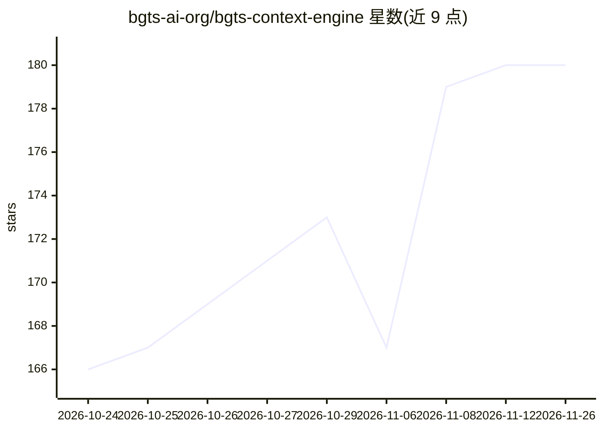

# bgts-ai-org/bgts-context-engine

⭐ 180 · Python · MIT · 推送 2026-11-16 · [GitHub](https://github.com/bgts-ai-org/bgts-context-engine) · 组织维护

**为 AI 编码 agent 提供确定性代码图上下文的检索引擎**

将代码仓库索引为符号/调用/引用/类型层级/HTTP 路由的代码图，存入 PostgreSQL + Apache AGE + pgvector，通过图遍历回答任务相关问题，检索路径中不含模型调用，同一提交上同一任务文本返回相同排序；嵌入仅用于任务文本无可识别名称时找入口点。提供 REST 服务（bce serve）、MCP stdio 服务（bce serve-mcp）与各编辑器一键初始化命令；可选的上下文选择器由 BCE_SELECTOR 指定模型后启用。组织可联系 BGTS 获取部署与调优咨询。

## 筛选速览

| 维度 | 判定 | 备注 |
|---|---|---|
| AI 角色 | `ai-ecosystem` | LLM/agent 周边工具 |
| 许可风险 | `permissive` | MIT |
| 部署形态 | `self-host` | docker 或自建部署 |
| 模型依赖 | — | README 未给出锁定关系 |
| 硬件要求 | — | 无带数字的原话,不猜 |
| 安装摩擦 | `low` | 无编译、无系统依赖或容器化 |
| 成熟度 | — | 结构信号不足 |

## 能力要点

- 代码图（符号/调用/引用/类型层级/HTTP 路由/跨语言桥接）索引与图遍历检索
- 检索路径无模型、无时钟、无随机性，同一提交同任务文本输出相同排序
- MCP + REST 双接口，提供 Cursor/Claude Code/OpenCode/Codex/Copilot 一键初始化命令
- 返回包含 anchors（依据）、coverage（置信与 commit_mismatch）、detail_level（按图距离衰减）的排序结果

## 适用场景

- 让编码 agent 在陌生仓库中先定位相关文件再改代码
- 排查改某符号会影响哪些调用方的扩散范围
- 需要可复现的上下文来源以便回放审计 agent 的错误修改

## 场景标签

`编码 Agent` `语义搜索` · 领域:编码与开发

## 证据(README 行号)

> L3: **Deterministic code-graph context for AI coding agents.**
> L38: BGTS Context Engine indexes your repositories into that graph — symbols, calls,
> L43: **The same task text, against the same commit, returns the same ranking.** No model in
> L112: bce serve        # REST at :8000/docs, web UI at :8000/ui/
> L113: bce serve-mcp    # MCP over stdio, for agents (install the [mcp] extra; see below)

## 星数曲线

2026-10-24 166 → 2026-11-26 180（+14）

---
*卡片 v1 · prompt 1.4 · 生成 2026-11-26 · 置信度 high · 依据 README sha `db09c94e09a3` · [字段定义](../../DATASET.md)*
