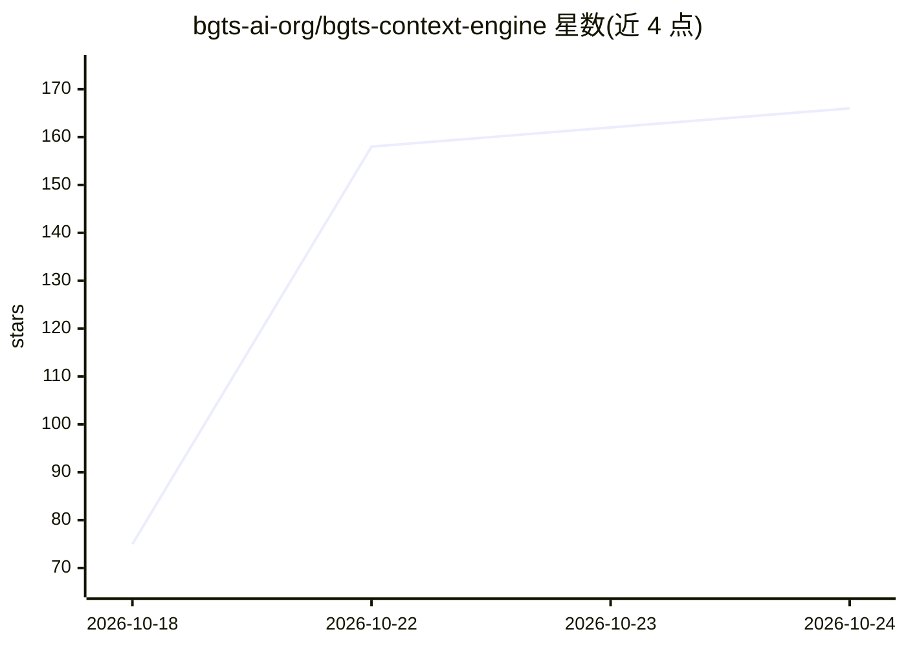

# bgts-ai-org/bgts-context-engine

⭐ 167 · Python · MIT · 推送 2026-10-23 · [GitHub](https://github.com/bgts-ai-org/bgts-context-engine) · 组织维护 · 中文 README

**给 AI 编程代理的确定性代码图谱上下文引擎**

将仓库索引为代码图谱（符号、调用、引用、类型层级、HTTP 路由、跨语言桥接），以图遍历加多源锚点方式为编程代理回答“改哪里、影响谁”类问题，输出带覆盖度报告的分级上下文包；检索路径不含 LLM，同任务同 commit 结果可复现，嵌入仅用于入口点发现。通过 MCP 与 REST 提供服务，兼容 Cursor、Claude Code、OpenCode 等编辑器/代理，可选 context selector 决策模型（默认关闭）。依赖 PostgreSQL 16 + Apache AGE + pgvector（docker compose 一键启动），PyPI 安装，MIT 许可。公司维护并提供咨询服务。

## 筛选速览

| 维度 | 判定 | 备注 |
|---|---|---|
| AI 角色 | `ai-ecosystem` | LLM/agent 周边工具 |
| 许可风险 | `permissive` | MIT |
| 部署形态 | `self-host` | docker 或自建部署 |
| 模型依赖 | — | README 未给出锁定关系 |
| 硬件要求 | — | 无带数字的原话,不猜 |
| 安装摩擦 | `low` | 无编译、无系统依赖或容器化 |
| 成熟度 | — | 结构信号不足 |

## 能力要点

- 代码图谱检索路径无 LLM，结果可复现
- 输出 anchors/coverage/detail_level 的分级上下文包
- 提供 MCP 与 REST 两种服务方式，含 Cursor/Claude Code/OpenCode 初始化命令
- 可选 context selector 决策模型裁剪上下文（默认关闭，--no-select 恢复确定性输出）

## 适用场景

- 让编程代理在陌生仓库中先问引擎再改代码，减少搜索轮次
- 查询改动的影响面（调用者、被调用者）并核验覆盖度
- 为团队搭建可复现、可审计的代码上下文服务

## 场景标签

 · 领域:开发者工具/AI 编程基础设施

## 证据(README 行号)

> L3: **Deterministic code-graph context for AI coding agents.**
> L113: bce serve-mcp    # MCP over stdio, for agents (install the [mcp] extra; see below)
> L38: BGTS Context Engine indexes your repositories into that graph — symbols, calls,

## 星数曲线

2026-10-18 75 → 2026-10-24 166（+91）

---
*卡片 v1 · prompt 1.4 · 生成 2026-10-22 · 置信度 high · 依据 README sha `b677345001ba` · [字段定义](../../DATASET.md)*
