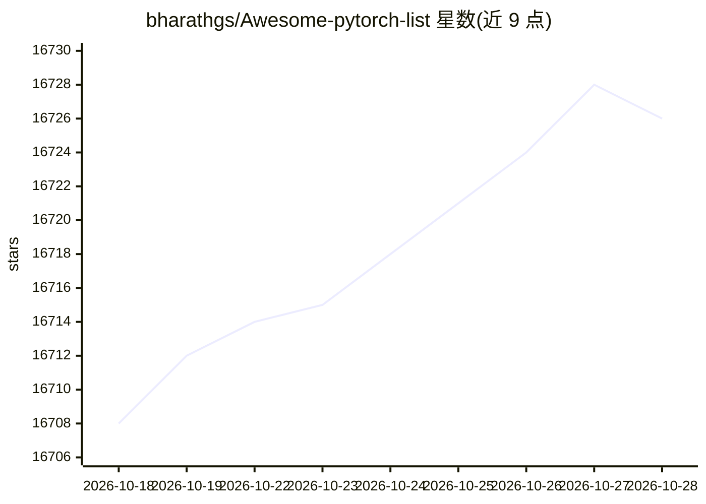

# bharathgs/Awesome-pytorch-list

⭐ 16,726 · 推送 2026-09-22 · [GitHub](https://github.com/bharathgs/Awesome-pytorch-list) · 个人维护

**为 PyTorch 用户整理的 GitHub 相关资源清单**

按类别组织的 PyTorch 相关 GitHub 项目清单，收录模型实现、辅助库与教程等内容。清单分为 PyTorch 相关库、NLP 与语音处理、计算机视觉、概率/生成模型库、其他库等章节，每条目为一行链接与简介。内容以引用外部仓库为主，README 本身不含安装或运行说明。

## 筛选速览

| 维度 | 判定 | 备注 |
|---|---|---|
| AI 角色 | `ai-knowledge` | 知识聚合/清单类 |
| 许可风险 | `none` | — |
| 部署形态 | `None` |  |
| 模型依赖 | — | README 未给出锁定关系 |
| 硬件要求 | — | 无带数字的原话,不猜 |
| 安装摩擦 | `medium` | 含编译或系统依赖之一 |
| 成熟度 | — | 结构信号不足 |

## 动量与使用信号

- 维护:`active` — 距上次 push 26.1 天,年发版 0,76 位贡献者
- 涨星:近 1 天 **+2**(自 20261016 起算)
- 安装:github 包 `release-assets` 月下载无数据

## 能力要点

- 收录 NLP 与语音处理类 PyTorch 项目 44 条
- 收录计算机视觉类项目 37 条
- 收录概率/生成模型库 10 条
- 按领域分章节组织的目录结构

## 适用场景

- 查找某个 NLP 或 CV 任务的 PyTorch 实现
- 为深度学习项目挑选可复用的辅助库
- 浏览 PyTorch 生态中的语音、生成模型等工具

## 场景标签

`精选清单` · 领域:学习与行业

## 证据(README 行号)

> L1: Awesome-Pytorch-list
> L7: ## Pytorch & related libraries
> L12: ### NLP & Speech Processing:

## 星数曲线

2026-10-18 16,708 → 2026-10-28 16,726（+18）

---
*卡片 v1 · prompt 1.4 · 生成 2026-10-18 · 置信度 high · 依据 README sha `b0cd9ed67615` · [字段定义](../../DATASET.md)*
