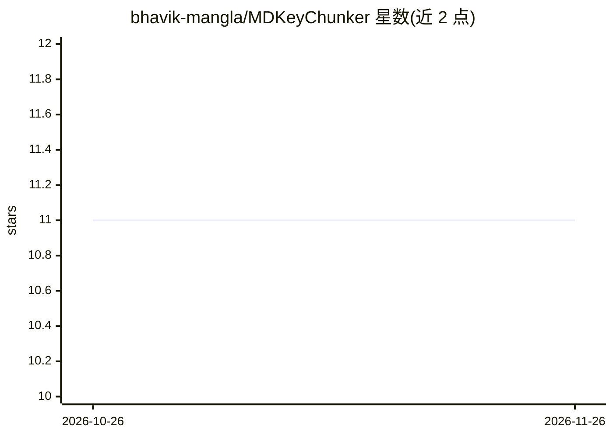

# bhavik-mangla/MDKeyChunker

⭐ 11 · Python · MIT · 推送 2026-10-26 · [GitHub](https://github.com/bhavik-mangla/MDKeyChunker) · [官网](https://pypi.org/project/mdkeychunker/) · 个人维护

**面向 RAG 的标题感知分块库与检索栈诊断工具**

提供 Markdown 的标题感知分块（按章节路径生成带前缀的 embed_text，512 token 上限，代码块/表格/列表不切断），核心零依赖。附带 mk.diagnose：在自有文档与标注问题上对比混合检索、更强嵌入器、重排器与 LLM 富化的收益，给出配对 bootstrap 置信区间与 n 不足时的 inconclusive 结论；支持命令行、可自带检索器或传入 LangChain/LlamaIndex 输出，可选 extras 接入 OpenAI 兼容服务、Anthropic、tiktoken、BM25、sentence-transformers 等。默认值来自对 Qasper 与 FreshStack 共 1186 个问题的确证性研究，限定英文语料。

## 筛选速览

| 维度 | 判定 | 备注 |
|---|---|---|
| AI 角色 | `ai-ecosystem` | LLM/agent 周边工具 |
| 许可风险 | `permissive` | MIT |
| 部署形态 | `library` | 以包/库形式分发 |
| 模型依赖 | local-ok | 支持本地模型 |
| 硬件要求 | — | 无带数字的原话,不猜 |
| 安装摩擦 | `low` | 无编译、无系统依赖或容器化 |
| 成熟度 | — | 结构信号不足 |

## 能力要点

- 标题感知分块：章节路径前缀、字符偏移、内容稳定 id、token 计数
- mk.diagnose 判断应升级检索器/分块还是支付每块 LLM 调用，附置信区间
- 核心零依赖，可选 extras 接入 OpenAI 兼容服务器、Claude、bm25s、sentence-transformers
- 提供 LangChain/LlamaIndex 适配器与 Colab 快速开始笔记本

## 适用场景

- 为 RAG 管道生成带章节结构的文档分块并建立索引
- 在自有文档上诊断混合检索是否优于纯稠密检索、重排器是否有收益
- 评估 LLM 富化（contextual retrieval）在特定语料上的性价比
- 对比不同分块器在同一组标注问题上的证据召回

## 场景标签

`RAG` `模型评测` · 领域:评测与运维

## 证据(README 行号)

> L11: **Header-aware chunking for RAG, and a diagnostic that tells you where to spend:
> L65: or pass LangChain / LlamaIndex outputs. `diagnose` scores gold *evidence text*, not chunk
> L116: |`mdkeychunker[langchain]`, `[llamaindex]`|framework adapters (`langchain-text-splitters`, `llama-index-core`)|

## 星数曲线

2026-10-26 11 → 2026-11-26 11（+0）

---
*卡片 v1 · prompt 1.4 · 生成 2026-11-18 · 置信度 high · 依据 README sha `566654a49ad0` · [字段定义](../../DATASET.md)*
