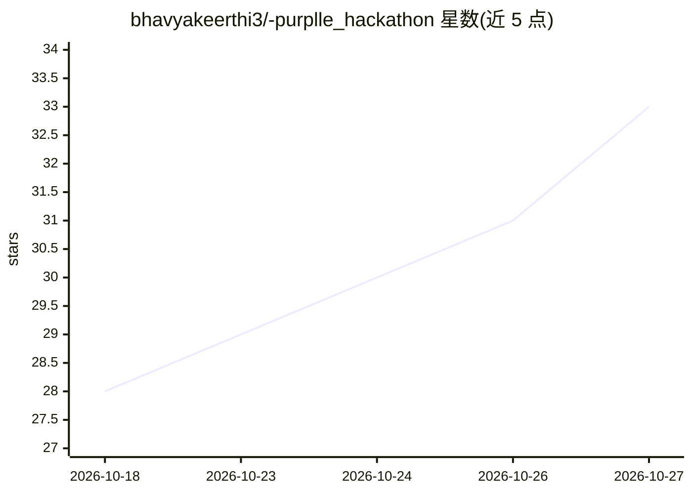

# bhavyakeerthi3/-purplle_hackathon

⭐ 33 · HTML · 推送 2026-06-22 · [GitHub](https://github.com/bhavyakeerthi3/-purplle_hackathon) · 个人维护

**把 CCTV 录像转为门店客流与销售分析的平台**

面向 Purplle 零售门店的黑客松项目：用 YOLOv8 做行人检测、ByteTrack 做多目标跟踪，按摄像机多边形区域划分生成进出、驻留、排队完成/放弃等 JSONL 事件，产出客流、热力图、队列等待、转化漏斗、销售相关性与运营异常分析。提供 FastAPI REST API、SSE 事件回放流、本地 dashboard 与 Vercel 静态演示版；仓库内置演示数据，支持 Docker Compose 一键运行，也有完整本地视频处理管线。人口统计端点为演示模式的聚合标签，README 列出了生产部署的隐私与升级建议。

## 筛选速览

| 维度 | 判定 | 备注 |
|---|---|---|
| AI 角色 | `ai-native` | 本体是模型或模型工具 |
| 许可风险 | `none` | — |
| 部署形态 | `self-host` | docker 或自建部署 |
| 模型依赖 | — | README 未给出锁定关系 |
| 硬件要求 | — | 无带数字的原话,不猜 |
| 安装摩擦 | `low` | 无编译、无系统依赖或容器化 |
| 成熟度 | — | 结构信号不足 |

## 能力要点

- YOLOv8 + ByteTrack 视频处理管线生成六类结构化事件
- FastAPI REST API（/api/v1）含 Pydantic 校验与 SSE 事件流
- 2 门店 8 摄像机的客流/热力图/队列/转化漏斗/异常分析
- Docker Compose 一键运行，Docker 构建时自动生成演示数据

## 适用场景

- 门店团队了解顾客进店到成交全流程的转化情况
- 查看各区域驻留时长与拥挤度热力图
- 监控排队等待与弃队等运营异常
- 本地跑通完整 CCTV 视频分析管线并查看 dashboard

## 场景标签

`图像视频处理` `数据分析` · 领域:效率与自动化

## 证据(README 行号)

> L30: - YOLOv8 person detection.
> L31: - ByteTrack multi-object tracking.

## 星数曲线

2026-10-18 28 → 2026-10-27 33（+5）

---
*卡片 v1 · prompt 1.4 · 生成 2026-10-26 · 置信度 high · 依据 README sha `6b59443db830` · [字段定义](../../DATASET.md)*
