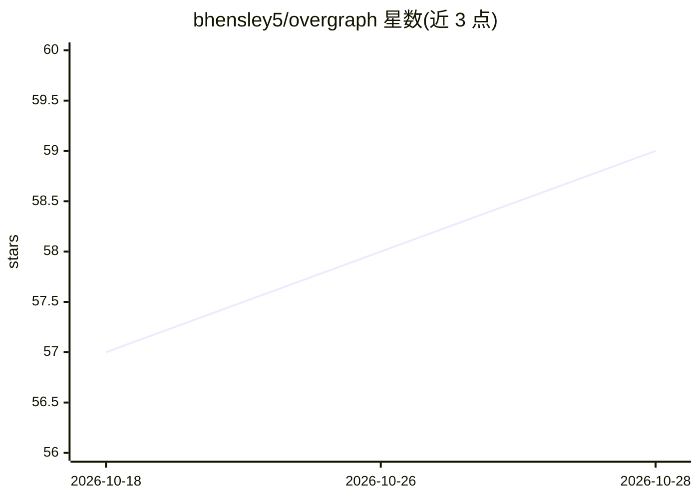

# bhensley5/overgraph

⭐ 59 · Rust · Apache-2.0 · 推送 2026-10-27 · [GitHub](https://github.com/bhensley5/overgraph) · [官网](https://overgraph.io) · 个人维护

**进程内嵌入式图数据库，内置稠密/稀疏向量检索，面向 Agent 记忆与 Graph RAG**

纯 Rust 实现的嵌入式图数据库，以库形式在用户进程内运行，无需独立服务或容器；通过 napi-rs 与 PyO3 提供 Node.js 与 Python 原生绑定，另支持 Rust 直接使用。核心能力包括：加权节点/边与时间有效性窗口、衰减打分、显式写事务、稠密 HNSW 与稀疏倒排向量索引、混合检索融合，以及图邻域限定范围的向量查询；同时提供 GQL/Cypher 风格查询语言。面向构建 AI Agent 记忆、知识图谱、RAG 检索管道与语义搜索的开发者，预编译二进制覆盖 macOS/Linux/Windows，无需 Rust 工具链。

## 筛选速览

| 维度 | 判定 | 备注 |
|---|---|---|
| AI 角色 | `ai-ecosystem` | LLM/agent 周边工具 |
| 许可风险 | `permissive` | Apache-2.0 |
| 部署形态 | `library` | 以包/库形式分发 |
| 模型依赖 | — | README 未给出锁定关系 |
| 硬件要求 | — | 无带数字的原话,不猜 |
| 安装摩擦 | `medium` | 含编译或系统依赖之一 |
| 成熟度 | — | 结构信号不足 |

## 能力要点

- 图结构与稠密/稀疏向量索引同引擎存储，支持图邻域限定范围的向量检索
- 稠密 HNSW + 稀疏 SPLADE/BGE-M3 + 混合融合检索，无需外部向量库
- 时间窗口边、衰减打分（exp(-λ·age)）与自动保留策略，适合 Agent 记忆老化
- GQL/Cypher 风格查询语言与函数式 API 双通道，Rust/Node.js/Python 三语言同一引擎

## 适用场景

- 为 AI Agent 存储对话、工具输出与实体关系，并按语义相似度检索
- 在 Graph RAG 管道中结合图结构与向量相似度做增强检索
- 构建知识图谱并进行最短路径、PageRank、连通性等图分析
- 把图数据库作为文件夹嵌入应用，免去独立数据库服务的运维

## 场景标签

`Agent 记忆` `知识图谱` `向量数据库` · 领域:Agent 开发

## 证据(README 行号)

> L5:  Built for AI agent memory, knowledge graphs, RAG pipelines, and semantic search.
> L20: - **AI agent memory.** Store conversations, tool outputs, entity relationships. Attach embeddings to nodes and retr
> L23: - **RAG pipelines.** Graph-augmented retrieval with vector search scoped to graph neighborhoods. Combine embedding 

## 星数曲线

2026-10-18 57 → 2026-10-28 59（+2）

---
*卡片 v1 · prompt 1.4 · 生成 2026-10-24 · 置信度 high · 依据 README sha `22aef408cb81` · [字段定义](../../DATASET.md)*
