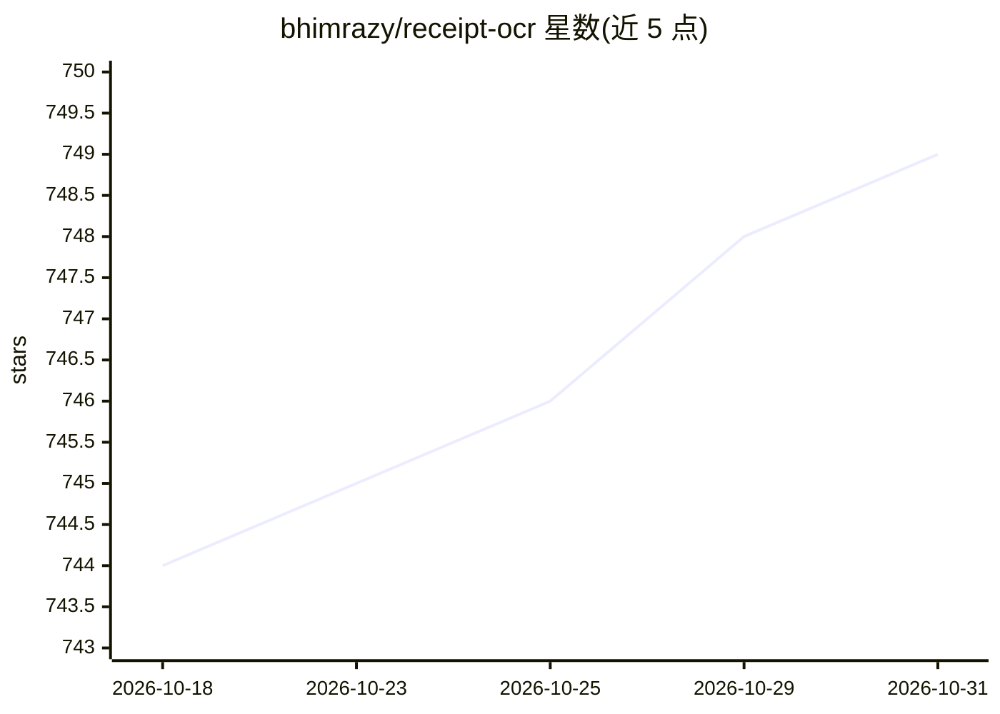

# bhimrazy/receipt-ocr

⭐ 749 · Python · MIT · 推送 2026-10-25 · [GitHub](https://github.com/bhimrazy/receipt-ocr) · [官网](https://pypi.org/project/receipt-ocr) · 个人维护

**收据图片 OCR 与 LLM 结构化数据提取引擎**

面向收据/发票图像处理的 Python 项目，含两个模块：receipt-ocr 包通过调用 LLM（OpenAI/Gemini/Groq 等 OpenAI 兼容接口）从收据图片提取商户名、地址、明细、总额等结构化 JSON，提供 CLI、编程 API 与 FastAPI 服务；tesseract_ocr 模块基于 Tesseract 做原始文本 OCR，提供 CLI 与 Docker 服务。安装方式为 pip install receipt-ocr，也可用 docker compose 运行 REST 服务；LLM 路径需配置 API key，本地 Tesseract 路径需系统安装 Tesseract。

## 筛选速览

| 维度 | 判定 | 备注 |
|---|---|---|
| AI 角色 | `ai-native` | 本体是模型或模型工具 |
| 许可风险 | `permissive` | MIT |
| 部署形态 | `self-host` | docker 或自建部署 |
| 模型依赖 | locked-api |  |
| 硬件要求 | — | 无带数字的原话,不猜 |
| 安装摩擦 | `low` | 无编译、无系统依赖或容器化 |
| 成熟度 | — | 结构信号不足 |

## 能力要点

- LLM 驱动的收据结构化 JSON 提取（商户、明细、总额等字段）
- 支持 OpenAI / Gemini / Groq 等多个 LLM provider
- 提供 CLI、Python 编程 API 与 FastAPI/Docker 网络服务
- 另含 Tesseract 模块做原始文本 OCR

## 适用场景

- 把纸质或电子收据批量转成结构化账单数据
- 在我的应用中集成收据识别与费用字段提取 API
- 无 LLM 依赖时用本地 Tesseract 提取收据原文文本

## 场景标签

`OCR` `文档解析` · 领域:知识与检索

## 证据(README 行号)

> L9: This repository provides a comprehensive solution for **Optical Character Recognition (OCR)** on receipt images, fea
> L42: - **`src/receipt_ocr/`**: A new package for abstracting general receipt processing logic, including CLI, programmat
> L97:  This command will use the configured LLM provider to extract structured data from the receipt image.

## 星数曲线

2026-10-18 744 → 2026-10-31 749（+5）

---
*卡片 v1 · prompt 1.4 · 生成 2026-10-22 · 置信度 high · 依据 README sha `eb1b617b23f7` · [字段定义](../../DATASET.md)*
