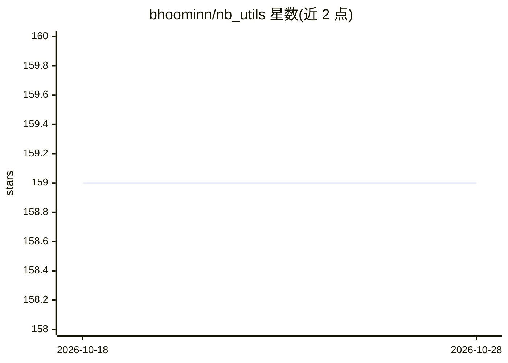

# bhoominn/nb_utils

⭐ 159 · Dart · MIT · 推送 2026-09-20 · [GitHub](https://github.com/bhoominn/nb_utils) · [官网](https://pub.dev/packages/nb_utils) · 个人维护

**Flutter 开发者通用组件与工具方法集合包**

面向 Flutter/Dart 开发者的 pub 包，提供常用 Widget（AppButton、AppTextField、Responsive、RatingBarWidget、SnapHelperWidget 等）与各类扩展方法（String、int、BuildContext、DateTime、Widget 等），并含 Shared Preference 封装、MaterialYou 主题色读取、JWT 解码、网络状态检测、状态栏控制等系统方法。安装方式为 flutter pub add nb_utils，需在 main.dart 初始化；支持 Android/iOS/macOS/Web/Linux/Windows 六平台。初始化时可配置 Chat GPT key。

## 筛选速览

| 维度 | 判定 | 备注 |
|---|---|---|
| AI 角色 | `ai-enhanced` | 去掉 AI 部分产品仍成立 |
| 许可风险 | `permissive` | MIT |
| 部署形态 | `None` |  |
| 模型依赖 | — | README 未给出锁定关系 |
| 硬件要求 | — | 无带数字的原话,不猜 |
| 安装摩擦 | `low` | 无编译、无系统依赖或容器化 |
| 成熟度 | — | 结构信号不足 |

## 能力要点

- 提供常用 Widget 库（按钮、输入框、响应式布局、对话框等）
- 覆盖 String/int/DateTime/Widget 等类型的 Dart 扩展方法
- Shared Preference 封装、JWT 解码、网络状态检测等系统工具
- 支持 Android/iOS/macOS/Web/Linux/Windows 六平台

## 适用场景

- 快速搭建 Flutter 应用的设置页、表单与对话框
- 用扩展方法简化空值校验、格式化与导航跳转
- 读取 MaterialYou 主题色与检测网络连接状态

## 场景标签

 · 领域:移动/跨平台开发工具

## 证据(README 行号)

> L13: |Android|iOS|MacOS|Web|Linux|Windows|
> L58: ## Useful methods or extensions you will ever need

## 星数曲线

2026-10-18 159 → 2026-10-28 159（+0）

---
*卡片 v1 · prompt 1.4 · 生成 2026-10-22 · 置信度 high · 依据 README sha `4bdb3d09a048` · [字段定义](../../DATASET.md)*
