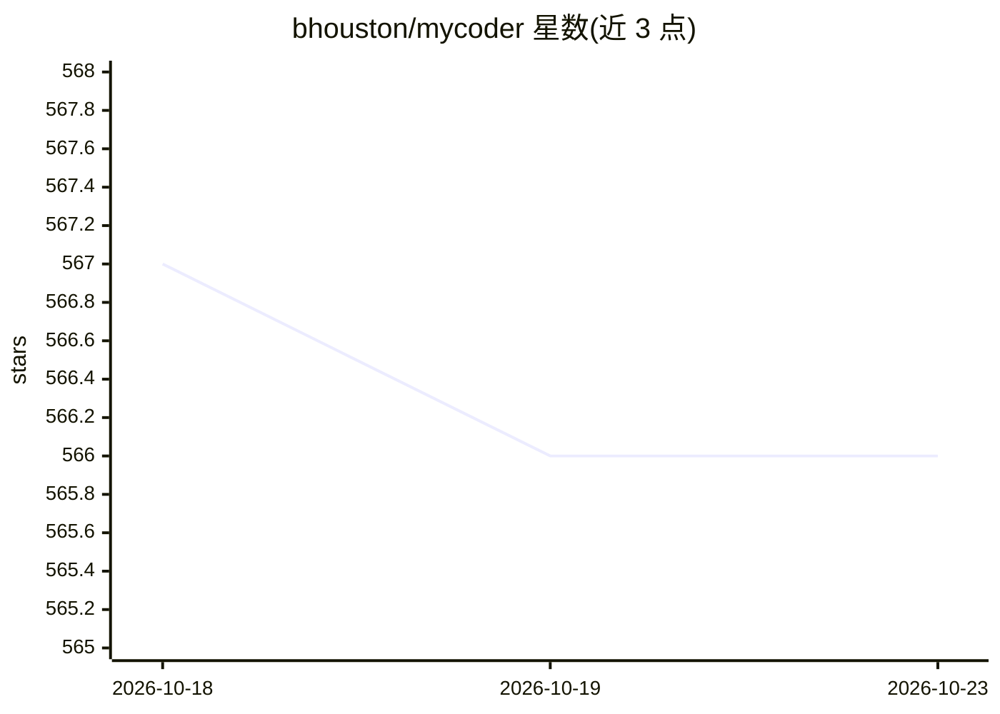

# bhouston/mycoder

⭐ 566 · TypeScript · MIT · 推送 2026-01-07 · [GitHub](https://github.com/bhouston/mycoder) · [官网](https://mycoder.ai) · 组织维护

**命令行 AI 编程代理，驱动编码任务自动化**

基于 npm 全局安装的命令行编码代理，接入 Anthropic Claude、OpenAI 模型与 Ollama。支持模块化工具系统、生成子代理并行执行任务、修改自身代码、MCP 外部上下文接入与上下文窗口自动压缩。可运行于交互模式，支持运行中通过 Ctrl+M 向主代理发送纠正信息；提供 GitHub 模式，通过 issue 评论中的 /mycoder 命令触发任务。浏览器自动化基于 Playwright，可检测系统已装浏览器作为替代。

## 筛选速览

| 维度 | 判定 | 备注 |
|---|---|---|
| AI 角色 | `ai-ecosystem` | LLM/agent 周边工具 |
| 许可风险 | `permissive` | MIT |
| 部署形态 | `library` | 以包/库形式分发 |
| 模型依赖 | local-ok | 支持本地模型 |
| 硬件要求 | — | 无带数字的原话,不猜 |
| 安装摩擦 | `low` | 无编译、无系统依赖或容器化 |
| 成熟度 | — | 结构信号不足 |

## 能力要点

- 接入 Anthropic Claude、OpenAI 模型与 Ollama
- 子代理并行执行与上下文窗口自动压缩
- GitHub issue/PR 集成，支持 /mycoder 评论命令触发
- 运行中交互式纠正（Ctrl+M）与 MCP 支持

## 适用场景

- 在终端通过自然语言驱动编码任务
- 在 GitHub issue 评论中触发代理实现 PR 或测试用例
- 长任务执行中向代理发送纠正信息调整方向

## 场景标签

`编码 Agent` · 领域:编码与开发

## 证据(README 行号)

> L3: Command-line interface for AI-powered coding tasks. Full details available on the main MyCoder.ai website and the Of
> L7: - 🤖 **AI-Powered**: Leverages Anthropic's Claude, OpenAI models, and Ollama for intelligent coding assistance

## 星数曲线

2026-10-18 567 → 2026-10-23 566（-1）

---
*卡片 v1 · prompt 1.4 · 生成 2026-10-21 · 置信度 high · 依据 README sha `beb399353418` · [字段定义](../../DATASET.md)*
