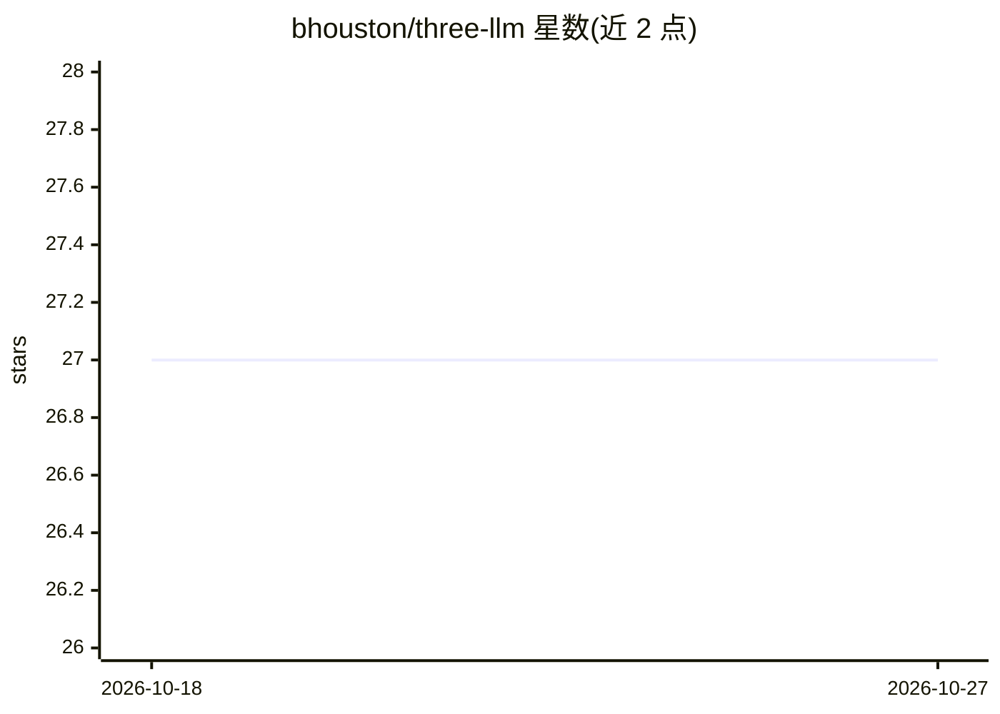

# bhouston/three-llm

⭐ 27 · TypeScript · MIT · 推送 2026-09-30 · [GitHub](https://github.com/bhouston/three-llm) · [官网](https://three-llm.ben3d.ca) · 个人维护

**浏览器内基于 Three.js/WebGPU 运行 LLM 推理的开源引擎**

用 Three.js 及其 TSL compute shader 系统实现 transformer 推理，模型在浏览器中通过 WebGPU 在用户 GPU 上执行，无需服务器端推理运行时。仓库为 pnpm monorepo：packages/three-llm 包含推理库、模型加载器、tokenizer 与 TSL 内核，packages/website 为 React 聊天演示。演示通过站点 /api/models/ 代理从公共 gs://three-llm bucket 加载 checkpoint，缺失文件时回退到 Hugging Face。要求 Node.js 20+ 与 pnpm 11，MIT 许可，由个人维护者 Ben Houston 发布。

## 筛选速览

| 维度 | 判定 | 备注 |
|---|---|---|
| AI 角色 | `ai-ecosystem` | LLM/agent 周边工具 |
| 许可风险 | `permissive` | MIT |
| 部署形态 | `library` | 以包/库形式分发 |
| 模型依赖 | — | README 未给出锁定关系 |
| 硬件要求 | — | 无带数字的原话,不猜 |
| 安装摩擦 | `low` | 无编译、无系统依赖或容器化 |
| 成熟度 | — | 结构信号不足 |

## 能力要点

- 用 Three.js TSL compute shader 实现 transformer 推理
- WebGPU 在浏览器内 GPU 上运行，无服务器端推理运行时
- 模型 checkpoint 支持 Hugging Face 回退加载
- monorepo 含推理库与 React 聊天演示两个包

## 适用场景

- 在网页中直接运行大语言模型而无需后端推理服务
- 构建本地浏览器聊天演示应用
- 基于 TSL 内核研究浏览器端 GPU 推理实现

## 场景标签

`推理引擎` `聊天机器人` · 领域:对话与助手

## 证据(README 行号)

> L10: Run large language models in the browser with WebGPU. `three-llm` implements transformer inference with Three.js an
> L34: - `packages/three-llm`: the inference library, model loaders, tokenizers, and TSL kernels

## 星数曲线

2026-10-18 27 → 2026-10-27 27（+0）

---
*卡片 v1 · prompt 1.4 · 生成 2026-10-26 · 置信度 high · 依据 README sha `d1f09ee18346` · [字段定义](../../DATASET.md)*
