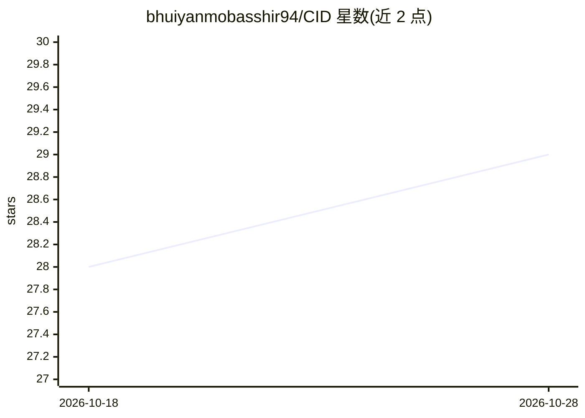

# bhuiyanmobasshir94/CID

⭐ 29 · Jupyter Notebook · Apache-2.0 · 推送 2026-09-26 · [GitHub](https://github.com/bhuiyanmobasshir94/CID) · 个人维护

**牛图像数据集：支持体重回归与品种分类研究**

CID 是一个面向计算机视觉与机器学习研究的牛图像数据集，附 CSV 元数据（标签与测量值），可监督学习用于体重估计（回归）与品种分类。图像存档与元数据托管于 S3，通过 wget 直接下载，包含主图像集与 YouTube 来源补充图像两部分；README 提供 pandas 预览与 PyTorch ImageFolder 加载示例。数据集制作流程在另一仓库，随附 ACM 论文 DOI 供引用。

## 筛选速览

| 维度 | 判定 | 备注 |
|---|---|---|
| AI 角色 | `ai-knowledge` | 知识聚合/清单类 |
| 许可风险 | `permissive` | Apache-2.0 |
| 部署形态 | `None` |  |
| 模型依赖 | — | README 未给出锁定关系 |
| 硬件要求 | — | 无带数字的原话,不猜 |
| 安装摩擦 | `low` | 无编译、无系统依赖或容器化 |
| 成熟度 | — | 结构信号不足 |

## 能力要点

- 牛图像与含标签/测量值的 CSV 元数据
- 含 YouTube 来源图像存档以增加多样性
- 提供 pandas 与 PyTorch 加载示例
- 附 ACM 出版物 DOI 与 BibTeX

## 适用场景

- 做牛体重估计回归实验的基准数据
- 做牛品种分类任务的训练与评测
- 为畜牧/agritech 视觉研究提供可复现数据

## 场景标签

 · 领域:计算机视觉/农业畜牧

## 证据(README 行号)

> L3: A curated dataset of cattle images and metadata intended for computer vision and machine learning tasks such as weig
> L7: Cattle livestock trading and management are growing rapidly. Accurate, automated tools for estimating weight and ide

## 星数曲线

2026-10-18 28 → 2026-10-28 29（+1）

---
*卡片 v1 · prompt 1.4 · 生成 2026-10-26 · 置信度 high · 依据 README sha `070abd29861c` · [字段定义](../../DATASET.md)*
