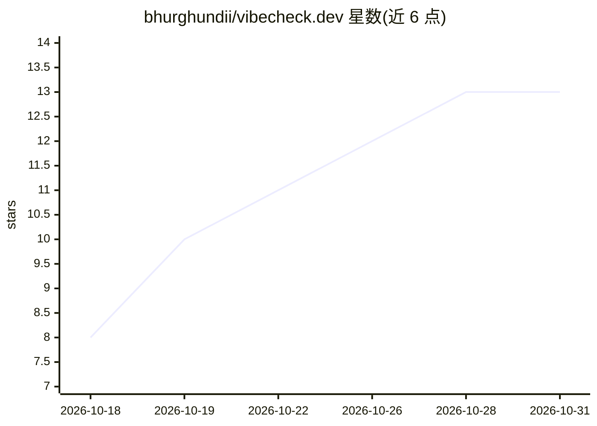

# bhurghundii/vibecheck.dev

⭐ 13 · Python · MIT · 推送 2026-10-30 · [GitHub](https://github.com/bhurghundii/vibecheck.dev) · [官网](https://bhurghundii.com/vibecheck.dev/) · 个人维护

**自托管 PR 合并门禁：用 AI 出题检验作者是否理解自己的代码**

面向 GitHub Pull Request 的自托管合并门禁服务：读取 PR diff 生成理解度测验（首个问题固定为高层解释，其后每 15 行变更出一题），作者逐题作答后由 Claude 依据对 diff 的盲解读进行评分，通过则以 vibecheck/verdict commit status 放行合并，未通过则合并被阻止。以 FastAPI 服务形式部署（Docker Compose + Postgres + GitHub Actions 工作流），BYOK 提供 Anthropic key。面向评审者、工程团队与开源项目维护者；明确声明不做代码审查，只检验作者理解，产品仍处早期阶段。

## 筛选速览

| 维度 | 判定 | 备注 |
|---|---|---|
| AI 角色 | `ai-native` | 本体是模型或模型工具 |
| 许可风险 | `permissive` | MIT |
| 部署形态 | `self-host` | docker 或自建部署 |
| 模型依赖 | locked-api |  |
| 硬件要求 | — | 无带数字的原话,不猜 |
| 安装摩擦 | `low` | 无编译、无系统依赖或容器化 |
| 成熟度 | `idea` | |

## 能力要点

- 每 15 行变更生成一道锚定 diff 片段的理解题
- Claude 对答案评分，通过后输出 vibecheck/verdict commit status 阻塞/放行合并
- 无需 GitHub App/OAuth/webhook，仅一个工作流文件 + bearer token 接入 FastAPI 服务
- Docker Compose 一条命令自托管，BYOK Anthropic key

## 适用场景

- 团队要求 PR 作者在合并前证明理解了变更
- 过滤未经阅读的 AI 生成大型 PR
- 开源项目设置廉价的低质量 PR 门槛

## 场景标签

 · 领域:开发工具/代码流程治理

## 证据(README 行号)

> L15: 1. vibecheck reads the code change and generates a few questions about it. It then comments on the PR with a link t
> L17: 3. An AI grader marks each answer against the actual change. You can tune how much detail warrants a pass here.

## 星数曲线

2026-10-18 8 → 2026-10-31 13（+5）

---
*卡片 v1 · prompt 1.4 · 生成 2026-10-31 · 置信度 high · 依据 README sha `67ae7c5542a5` · [字段定义](../../DATASET.md)*
