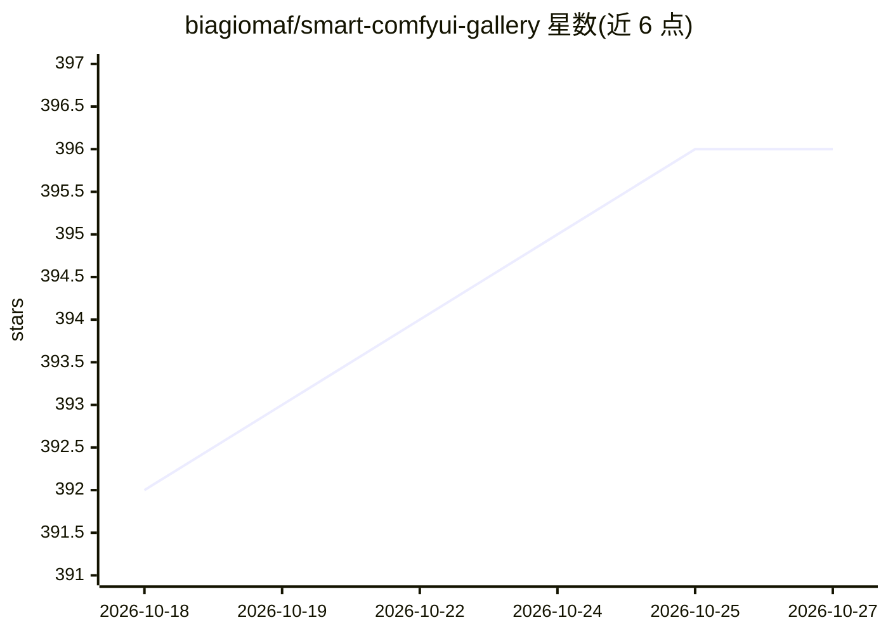

# biagiomaf/smart-comfyui-gallery

⭐ 396 · HTML · MIT · 推送 2026-10-18 · [GitHub](https://github.com/biagiomaf/smart-comfyui-gallery) · [官网](https://smartgallerydam.com) · 个人维护

**面向 ComfyUI 用户的本地数字资产管理器：浏览、检索、管理与生成 AI 产出**

基于浏览器的本地优先（local-first）数字资产管理系统（DAM），面向使用 ComfyUI 的 AI 创作者与制作团队。功能包括：索引并浏览海量生成图片/视频/音频，按 prompt、模型、LoRA、日期、评论检索；Remix Engine 允许不打开 ComfyUI 界面直接提取工作流并提交生成队列；Queue Deck 实时监控生成进度与 GPU/VRAM 负载；提供客户端分享门户、状态标签、虚拟合集与角色协作。OmniQuery 支持用自然语言让 LLM 生成 SQL 查询图库。以独立进程运行，不依赖 ComfyUI 存活，支持 Windows/macOS/Linux/Docker。

## 筛选速览

| 维度 | 判定 | 备注 |
|---|---|---|
| AI 角色 | `ai-enhanced` | 去掉 AI 部分产品仍成立 |
| 许可风险 | `permissive` | MIT |
| 部署形态 | `desktop` | 安装包/桌面程序 |
| 模型依赖 | — | README 未给出锁定关系 |
| 硬件要求 | — | 无带数字的原话,不猜 |
| 安装摩擦 | `low` | 无编译、无系统依赖或容器化 |
| 成熟度 | — | 结构信号不足 |

## 能力要点

- 索引 ComfyUI 生成资产并按 prompt/模型/LoRA/参数检索
- Remix Engine 不打开 ComfyUI 界面即可生成与排队
- OmniQuery 自然语言查询图库（LLM 生成 SQL）
- LoRA Synergy 离线读取 safetensors 头校验 checkpoint 兼容性
- 客户端分享门户与状态标签、虚拟合集

## 适用场景

- 管理数万条 ComfyUI 生成结果并快速定位所需素材
- 在手机上浏览、筛选并触发生成任务
- 向客户展示精选合集并收集评分与评论，不暴露工作流
- 在未安装 ComfyUI 的机器上通过网络链接输出文件夹管理图库

## 场景标签

`图像生成` `数据分析` · 领域:效率与自动化

## 证据(README 行号)

> L29: * 🎨 **Remix Engine & Nodepad**: Generate, edit node JSONs, and create variations through a clean native interface, 
> L51: |🧠 **OmniQuery**|Search your gallery in plain English, any criteria. Let AI write complex SQL queries to find hyper
> L68: SmartGallery DAM runs as a fully independent process, outside ComfyUI's environment. It keeps indexing and organizi

## 星数曲线

2026-10-18 392 → 2026-10-27 396（+4）

---
*卡片 v1 · prompt 1.4 · 生成 2026-10-21 · 置信度 high · 依据 README sha `4ee6d13b8a07` · [字段定义](../../DATASET.md)*
