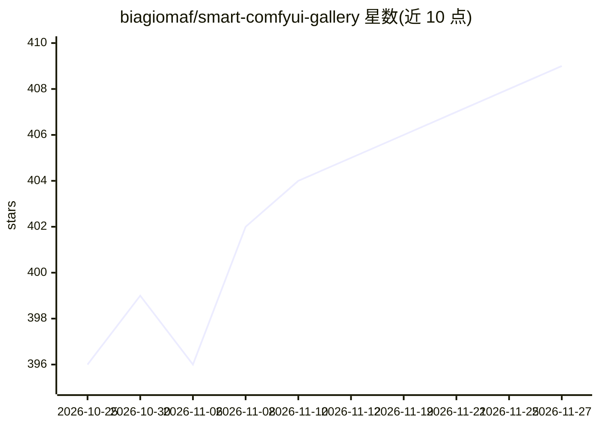

# biagiomaf/smart-comfyui-gallery

⭐ 409 · HTML · MIT · 推送 2026-11-26 · [GitHub](https://github.com/biagiomaf/smart-comfyui-gallery) · [官网](https://smartgallerydam.com) · 个人维护

**面向 ComfyUI 创作者的自托管数字资产管理与画廊系统**

本地优先、浏览器访问的数字资产管理系统，针对 ComfyUI 及 AI 生成库：自动索引生成文件并关联工作流、提示词、模型与 LoRA 元数据，支持按提示词/模型/日期过滤、SQL 查询与自然语言检索（AI 生成 SQL 的 OmniQuery）。提供不打开 ComfyUI 画布的 Remix 生成界面、队列监控（GPU/VRAM 负载）、文件管理器、状态标签、评分、虚拟合集与面向客户的分享门户，支持视频音频与 FFmpeg 转码。独立进程运行，ComfyUI 卸载后仍可管理库。

## 筛选速览

| 维度 | 判定 | 备注 |
|---|---|---|
| AI 角色 | `ai-enhanced` | 去掉 AI 部分产品仍成立 |
| 许可风险 | `permissive` | MIT |
| 部署形态 | `desktop` | 安装包/桌面程序 |
| 模型依赖 | — | README 未给出锁定关系 |
| 硬件要求 | — | 无带数字的原话,不猜 |
| 安装摩擦 | `low` | 无编译、无系统依赖或容器化 |
| 成熟度 | — | 结构信号不足 |

## 能力要点

- OmniQuery：用自然语言描述条件，AI 生成 SQL 检索媒体库
- Remix Engine 无需打开 ComfyUI 即可生成与改工作流 JSON
- Queue Deck 实时监控生成队列与 GPU/VRAM 负载
- 支持 A1111、Forge、Civitai 图片元数据混合检索

## 适用场景

- 管理上万张 ComfyUI 生成图并按提示词/模型查找
- 在手机上浏览、筛选并触发图像生成
- 向客户展示合集审批作品而不暴露提示词与工作流
- 在 NAS 或独立机器上自托管画廊

## 场景标签

`图像生成` · 领域:内容生成

## 证据(README 行号)

> L68: SmartGallery DAM runs as a fully independent process, outside ComfyUI's environment. It keeps indexing and organizi
> L97: **SmartGallery DAM** is the evolution of *SmartGallery for ComfyUI*. What started as a fast local gallery for brows
> L51: |🧠 **OmniQuery**|Search your gallery in plain English, any criteria. Let AI write complex SQL queries to find hyper

## 星数曲线

2026-10-25 396 → 2026-11-27 409（+13）

---
*卡片 v1 · prompt 1.4 · 生成 2026-11-27 · 置信度 high · 依据 README sha `0fbf9b5caf7f` · [字段定义](../../DATASET.md)*
