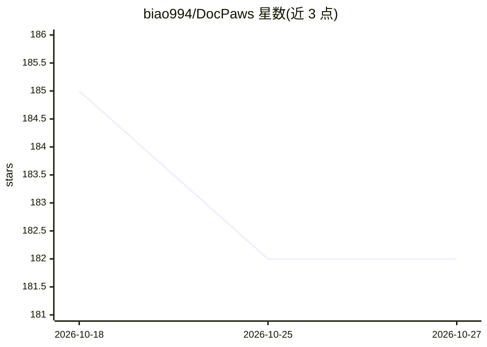

# biao994/DocPaws

⭐ 182 · Python · MIT · 推送 2026-10-17 · [GitHub](https://github.com/biao994/DocPaws) · 个人维护 · 中文 README

**工程化 RAG 文档助手：知识库、PDF 索引与引用溯源拒答**

面向个人知识库管理的 RAG 文档问答应用：后端 FastAPI + SQLModel + Celery，前端 Vue 3 + Vite。支持 PDF 上传与 manifest 增量索引、scope（全库/文件夹/单文件）检索、SSE 流式对话、来源引用展示，以及检索距离阈值拒答机制（RETRIEVAL_MAX_DISTANCE）。LLM 与 Embedding 通过 API Key 接入（DeepSeek / OpenAI 兼容 / SiliconFlow 等）。自带 Golden 20 可复现评估与 88 条后端测试，基础设施用 docker compose 起 Postgres + Redis + MinIO，索引可选 Celery Worker。

## 筛选速览

| 维度 | 判定 | 备注 |
|---|---|---|
| AI 角色 | `ai-native` | 本体是模型或模型工具 |
| 许可风险 | `permissive` | MIT |
| 部署形态 | `self-host` | docker 或自建部署 |
| 模型依赖 | locked-api |  |
| 硬件要求 | — | 无带数字的原话,不猜 |
| 安装摩擦 | `low` | 无编译、无系统依赖或容器化 |
| 成熟度 | — | 结构信号不足 |

## 能力要点

- scope 三级检索（全库/文件夹/单文件）与流式 SSE 对话
- 检索距离阈值拒答机制，库外问题不生成回答
- PDF manifest 增量索引，可选 Celery 异步索引 Worker
- Golden 20 可复现 RAG 评估与 88 条后端测试

## 适用场景

- 搭建个人文档知识库并进行带引用的问答
- 限制回答范围到指定文件夹或单文件做定向查询
- 通过检索阈值拒答控制库外问题的幻觉回答

## 场景标签

`文档问答` `知识库管理` · 领域:知识与检索

## 证据(README 行号)

> L3: 工程化 RAG 文档助手：知识库管理、PDF 索引、流式对话、引用与检索阈值拒答。
> L23: **检索拒答** — 库外问题或距离未过阈值时拒答，避免幻觉。
> L31: - **检索距离阈值拒答**（`RETRIEVAL_MAX_DISTANCE`，详见 `backend/README.md`）

## 星数曲线

2026-10-18 185 → 2026-10-27 182（-3）

---
*卡片 v1 · prompt 1.4 · 生成 2026-10-22 · 置信度 mid · 依据 README sha `046a540006c2` · [字段定义](../../DATASET.md)*
