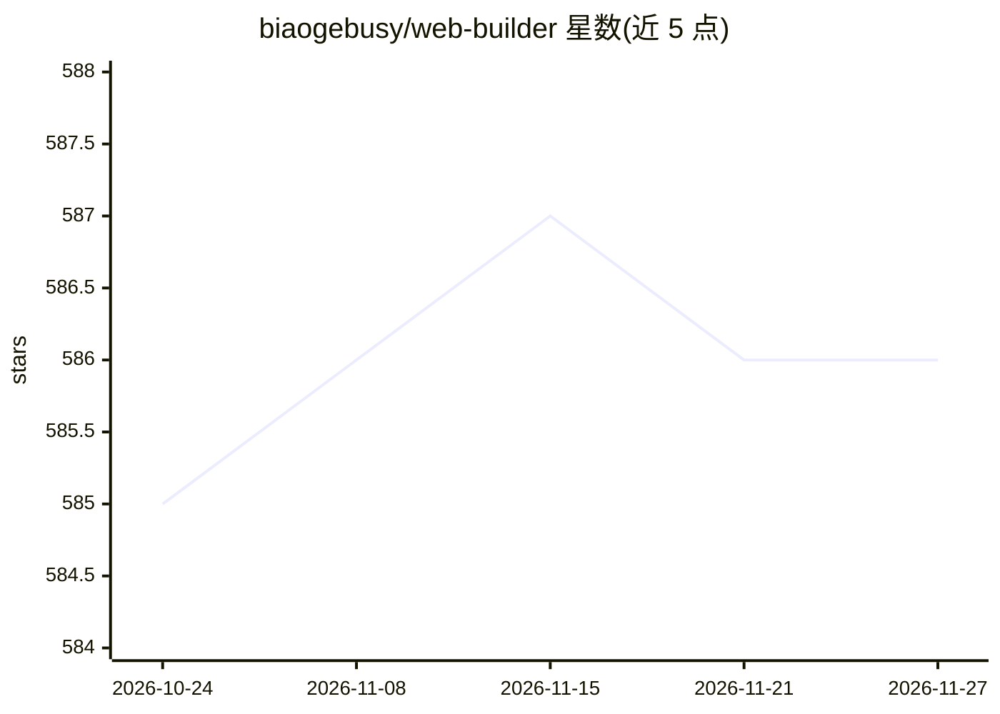

# biaogebusy/web-builder

⭐ 586 · TypeScript · AGPL-3.0 · 推送 2026-11-20 · [GitHub](https://github.com/biaogebusy/web-builder) · [官网](https://builder.design) · 个人维护 · 中文 README

**AI 对话生成 UI 的低代码建站与内容发布平台**

基于 Angular 20 与 TailwindCss 的低代码平台，将可视化拖拽 Builder、Drupal 内容管理与页面发布连接为一体。支持拖拽和代码两种模式构建页面与自定义组件，也可通过 AI 对话生成页面、组件与图片，经预览、审批和版本管理后发布到网站或小程序。提供 Claude Code 技能包覆盖 UI 构建、多语言翻译与配图提示词生成，另附配套 Taro 小程序与 Docker 部署方式。

## 筛选速览

| 维度 | 判定 | 备注 |
|---|---|---|
| AI 角色 | `ai-enhanced` | 去掉 AI 部分产品仍成立 |
| 许可风险 | `viral` | AGPL-3.0 |
| 部署形态 | `library` | 以包/库形式分发 |
| 模型依赖 | — | README 未给出锁定关系 |
| 硬件要求 | — | 无带数字的原话,不猜 |
| 安装摩擦 | `low` | 无编译、无系统依赖或容器化 |
| 成熟度 | — | 结构信号不足 |

## 能力要点

- 拖拽与代码双模式构建响应式页面和自定义组件
- AI 对话生成页面、组件与图片，DeepSeek 可生成自定义组件
- 配合 Drupal JSON:API 与 OAuth2 认证管理内容与发布
- 多主题、多语言、暗黑风格与历史版本管理

## 适用场景

- 拖拽搭建响应式官网和落地页并发布
- 通过 AI 对话一句话生成整个页面
- 管理小程序页面与组件数据
- Drupal 站点的内容页面可视化生产

## 场景标签

`代码生成` · 领域:编码与开发

## 证据(README 行号)

> L5:  信使 Web Builder 不只是响应式 UI 编辑器：它将 AI 驱动的可视化 Builder、Drupal 内容管理和页面发布连接在一起。
> L6:  你可以通过拖拽和代码模式构建页面与自定义组件，也可以通过 AI 对话生成页面、组件和图片，使用项目设计规范统一体验，经过预览、审批和版本管理后发布到网站或小程序。
> L122: - 前端：Angular 20 (standalone components、signals、zoneless change detection、incremental hydration) + Angular Material

## 星数曲线

2026-10-24 585 → 2026-11-27 586（+1）

---
*卡片 v1 · prompt 1.4 · 生成 2026-11-26 · 置信度 high · 依据 README sha `7512197a63b6` · [字段定义](../../DATASET.md)*
