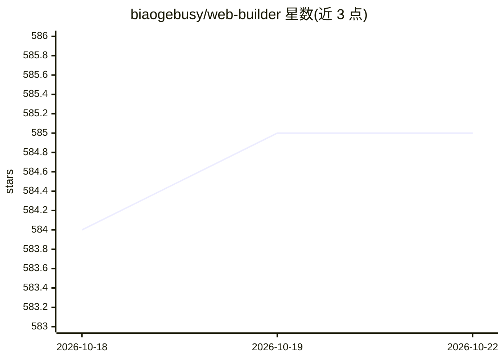

# biaogebusy/web-builder

⭐ 585 · TypeScript · AGPL-3.0 · 推送 2026-09-12 · [GitHub](https://github.com/biaogebusy/web-builder) · [官网](https://builder.design) · 个人维护 · 中文 README

**基于 Angular+TailwindCSS 的拖拽式低代码建站平台**

开源低代码 Web 构建平台，以 Angular 20 + TailwindCSS 为前端、Drupal 作 Headless 后端（JSON:API + OAuth2），通过拖拽可视化构建响应式页面，支持动态自定义组件、多主题、暗黑模式、多语言、媒体库与页面历史版本，配套基于 Taro+NutUI 的小程序端。AI 部分包括 Builder Pro 的 AI 大模型生成 UI/页面、DeepSeek 生成自定义组件，以及面向 Claude Code 的 Web Builder Skills 技能包（UI 构建、JSON 翻译、配图提示词）。以 npm 源码方式本地运行，需 Node 22+ 环境。

## 筛选速览

| 维度 | 判定 | 备注 |
|---|---|---|
| AI 角色 | `ai-enhanced` | 去掉 AI 部分产品仍成立 |
| 许可风险 | `viral` | AGPL-3.0 |
| 部署形态 | `library` | 以包/库形式分发 |
| 模型依赖 | — | README 未给出锁定关系 |
| 硬件要求 | — | 无带数字的原话,不猜 |
| 安装摩擦 | `low` | 无编译、无系统依赖或容器化 |
| 成熟度 | — | 结构信号不足 |

## 能力要点

- 拖拽可视化构建基于 TailwindCSS 的动态组件页面
- Drupal Headless 后端（JSON:API、views、simple_oauth）
- Builder Pro 基于 AI 大模型生成 UI、页面与工具应用
- Web Builder Skills 提供 Claude Code 技能包（ui-builder/translate-json/web-image-prompt）

## 适用场景

- 可视化搭建多语言、多主题的响应式网站
- 通过 AI 一句话生成页面或自定义组件
- 同一 builder 管理小程序页面与组件
- 基于模板库与示例库快速产出着陆页

## 场景标签

`代码生成` · 领域:编码与开发

## 证据(README 行号)

> L5:  AI 生成UI和工具应用的低代码平台，国内首款开源的基于 Drupal 作为 Headless 的低代码，基于 TailwindCss，通过拖拽可视化快速构建现代化响应式UI、动态自定义组件、多主题、多语言的网站应用。AI-pow
> L33: |Layout builder|动态 layout，基于 TailwindCss 的动态组件，支持静态数据和 API 数据来源|
> L60: > 基于AI大模型生成UI、页面和工具应用，欢迎体验。

## 星数曲线

2026-10-18 584 → 2026-10-22 585（+1）

---
*卡片 v1 · prompt 1.4 · 生成 2026-10-21 · 置信度 high · 依据 README sha `58245d7fa9a3` · [字段定义](../../DATASET.md)*
