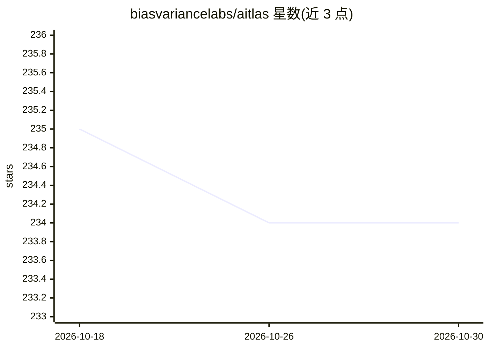

# biasvariancelabs/aitlas

⭐ 234 · Python · Apache-2.0 · 推送 2026-07-17 · [GitHub](https://github.com/biasvariancelabs/aitlas) · [官网](https://aitlas.readthedocs.io/) · 组织维护

**面向遥感卫星影像分析的机器学习工具箱，含AI就绪数据集仓库**

AiTLAS（Artificial Intelligence Toolbox for Earth Observation）提供用于卫星影像探索性与预测性分析的机器学习方法集合，覆盖土地利用/覆盖分类、作物类型预测、语义分割、变化检测与目标检测等任务，并附 AI 就绪的 EO 数据集仓库。面向 EO 专家与 AI 专家双向设计：前者可使用新 AI 方法，后者可获标准化 EO 数据以做基准测试。支持 16 个遥感基础模型及适配器，需 Python 3.12，通过 PyPI 或源码安装，以配置文件驱动训练运行。

## 筛选速览

| 维度 | 判定 | 备注 |
|---|---|---|
| AI 角色 | `ai-native` | 本体是模型或模型工具 |
| 许可风险 | `permissive` | Apache-2.0 |
| 部署形态 | `library` | 以包/库形式分发 |
| 模型依赖 | — | README 未给出锁定关系 |
| 硬件要求 | — | 无带数字的原话,不猜 |
| 安装摩擦 | `low` | 无编译、无系统依赖或容器化 |
| 成熟度 | — | 结构信号不足 |

## 能力要点

- 支持 16 个遥感基础模型（Prithvi、TerraMind、SatMAE 等）及数据-模型适配器
- 覆盖分类、语义分割、变化检测、目标检测多类任务架构
- CompositeModel 动态组装 backbone/neck/decoder/head
- 含 22 个数据集、500+ 模型的 Benchmark Arena 与语义数据目录生态

## 适用场景

- 对卫星影像做土地覆盖分类或作物类型预测
- 在遥感任务上适配和微调基础模型
- 用标准化 EO 数据集对深度学习方法做基准测试
- 做遥感变化检测（如洪水、考古遗址分割）

## 场景标签

`目标检测` `微调` `模型评测` · 领域:评测与运维

## 证据(README 行号)

> L5: The AiTLAS toolbox (Artificial Intelligence Toolbox for Earth Observation) includes state-of-the-art machine learnin
> L38: - **Change detection**: Added BIT, CGNet, ChangeFormer V6, ChangeMamba, ChangeVIT, CSSM, HRNet SiamConc, SiamCRNN, 

## 星数曲线

2026-10-18 235 → 2026-10-30 234（-1）

---
*卡片 v1 · prompt 1.4 · 生成 2026-10-22 · 置信度 high · 依据 README sha `7b9ccb75848f` · [字段定义](../../DATASET.md)*
